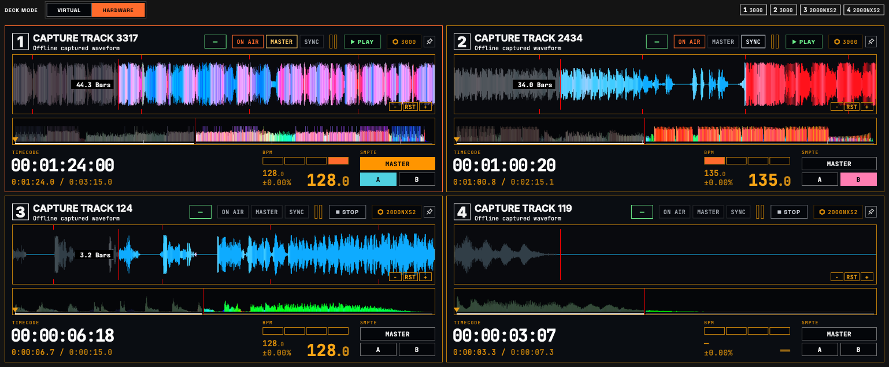

<picture>
  <source media="(prefers-color-scheme: dark)" srcset="docs/media/orvik-wordmark-dark.png">
  
</picture>

**CDJ와 DJM의 재생 정보를 조명, 영상 소프트웨어로**

**한국어** | [English](README.en.md)

[다운로드](https://github.com/Zesminseok/ORVIK/releases/latest) | [사용 설명서](docs/manual/ORVIK-manual-ko.md) | [변경 내역](CHANGELOG.md) | [문의](https://github.com/Zesminseok/ORVIK/issues)

## ORVIK는

PRO DJ LINK로 연결된 CDJ와 DJM에서 템포, 비트, 재생 위치, 곡 정보, 큐, 웨이브폼, 믹서 상태를 받아
TCNet, SMPTE 타임코드, OSC, DMX, MIDI로 내보냅니다. 장비를 제어하지 않고 읽기만 합니다.

2.0은 네이티브 앱(C++ / JUCE)으로 새로 만들었습니다. 1초 안에 켜지고 1.6보다 훨씬 가볍습니다.

## 주요 기능

| 기능 | 설명 |
| --- | --- |
| **DECKS** | 덱과 믹서 상태, 웨이브폼, 큐를 한눈에 |
| **SMPTE OUT** | 레이어 A, B, MASTER의 LTC, MTC, Art-Net 타임코드 |
| **OUTPUT** | 덱과 믹서 값을 OSC, Art-Net / sACN DMX, MIDI로 보내는 노드 편집기 |
| **SET LIST** | 곡별 타임코드 오프셋, 큐 편집 |
| **CUE CALL** | 그룹별 다음 큐 카운트다운, 음성 안내, 폰용 웹 페이지 |
| **SHORTCUT, MAP** | 키보드, MIDI, OSC, DMX로 ORVIK 조작 |

그 밖에 가상 덱, 웹 뷰어, 미러 모드, HISTORY, 7개 언어를 지원합니다.

## 설치

[최신 릴리스](https://github.com/Zesminseok/ORVIK/releases/latest)에서 운영체제에 맞는 파일을 받으세요.

| 운영체제 | 파일 |
| --- | --- |
| macOS 13.3 이상 (Apple Silicon) | `mac-arm64.dmg` |
| Windows 10, 11 (x64) | `win-x64.exe` (설치 없이 실행) |

1. macOS는 DMG를 열어 ORVIK를 응용 프로그램 폴더로 옮깁니다. Windows는 `.exe`를 바로 실행합니다.
2. 컴퓨터와 DJ 장비를 같은 네트워크에 연결합니다.
3. ORVIK 설정에서 그 네트워크 인터페이스를 고릅니다.

> [!NOTE]
> Intel Mac에서는 [1.6.3](https://github.com/Zesminseok/ORVIK/releases/tag/v1.6.3)을 쓰세요. 1.6의 설정은 2.0으로 옮겨지지 않습니다.

> [!TIP]
> macOS 앱은 Apple 공증을 받았습니다. Windows에서 SmartScreen 경고가 뜨면 **추가 정보 → 실행**을 누르세요.

> [!IMPORTANT]
> 베타입니다. 공연에 쓰기 전에 타임코드와 출력을 실제 수신 장비와 꼭 확인하세요.

## 개인정보와 네트워크

ORVIK는 인터넷으로 사용 기록을 보내지 않습니다.

로컬 네트워크에서 주고받는 것

 

| 기능 | 기본값 | 내용 |
| --- | --- | --- |
| PRO DJ LINK | 켜짐 | 'ORVIK' 장치로 참여해 곡 정보, 웨이브폼, 큐, 믹서 상태를 요청 |
| TCNet | 켜짐 | 곡 정보, 앨범아트, 재생 위치, BPM, 믹서 값을 보냄 |
| OUTPUT, SMPTE OUT | 꺼짐 | 정한 곳으로 OSC, DMX, MIDI, 타임코드를 보냄 |
| SHORTCUT 입력 | 꺼짐 | OSC(UDP 7700), Art-Net DMX(UDP 6454)를 받음 |
| 웹 뷰어 | 꺼짐 | TCP 8877, 4글자 코드, 암호화 없는 HTTP |
| 미러 | 켜짐 | CDJ가 없으면 같은 네트워크의 미러 서버에 자동 연결 (서버 제공은 꺼짐, TCP 8878) |
| 업데이트 확인 | 켜짐 | 12시간마다 GitHub에 최신 버전을 물음 (앱 버전만 보냄) |

- 음성 안내는 컴퓨터의 시스템 목소리로 만들며 밖으로 보내지 않습니다.
- 설정 폴더: macOS `~/Library/Application Support/com.zesminseok.orvik`, Windows `%APPDATA%\Zesminseok\ORVIK`
- HISTORY와 SET LIST는 앱을 새로 켜면 비워집니다. 남기려면 종료 전에 내보내세요.

문제를 로그로 남기기

 

1. 설정의 정보 섹션에서 **Option+Shift+A** (Windows **Alt+Shift+A**)를 누릅니다.
2. **로그 캡처**를 켜고, 문제를 재현합니다.
3. 다 쓰면 끕니다. 시간당 1GB 가까이 쌓일 수 있습니다.

로그에는 곡 제목, 장비 이름, IP, MAC이 들어갈 수 있으니 이슈에 올리기 전에 확인하세요.

## 문서

- 사용 설명서: [한국어](docs/manual/ORVIK-manual-ko.md), [English](docs/manual/ORVIK-manual-en.md), [日本語](docs/manual/ORVIK-manual-ja.md), [Español](docs/manual/ORVIK-manual-es.md), [Deutsch](docs/manual/ORVIK-manual-de.md), [Français](docs/manual/ORVIK-manual-fr.md), [繁體中文](docs/manual/ORVIK-manual-zh-TW.md)
- [변경 내역](CHANGELOG.md)
- 1.6.x의 FFmpeg 자료: [FFmpeg 안내](docs/third-party/FFMPEG.md) (2.0은 FFmpeg를 쓰지 않습니다)

## 후원

ORVIK는 무료 베타이며 기간 제한이 없습니다. 후원은 개발을 돕는 자발적인 선택이고, 후원해도 기능이 더 열리지 않습니다.
후원은 정식 제품의 구매나 예약이 아니며, 정식 버전이나 완성 시점을 보장하지 않습니다.

## 문의

- 버그, 요청: [GitHub Issues](https://github.com/Zesminseok/ORVIK/issues)
- Instagram: [@zes_minseok](https://instagram.com/zes_minseok)

## 라이선스

[앱 이용 조건](BINARY_LICENSE.md), [문서 이용 조건](LICENSE), [서드파티 고지](THIRD_PARTY_NOTICES.md)

이 저장소는 문서와 배포 파일만 제공하며 앱 소스 코드는 공개하지 않습니다.

ORVIK는 AlphaTheta, Pioneer DJ, TC Supply, Resolume과 관계없는 독립 호환 도구입니다. 제품명과 상표는 호환 대상을 설명하기 위해서만 씁니다. Art-Net™ Designed by and Copyright Artistic Licence.
