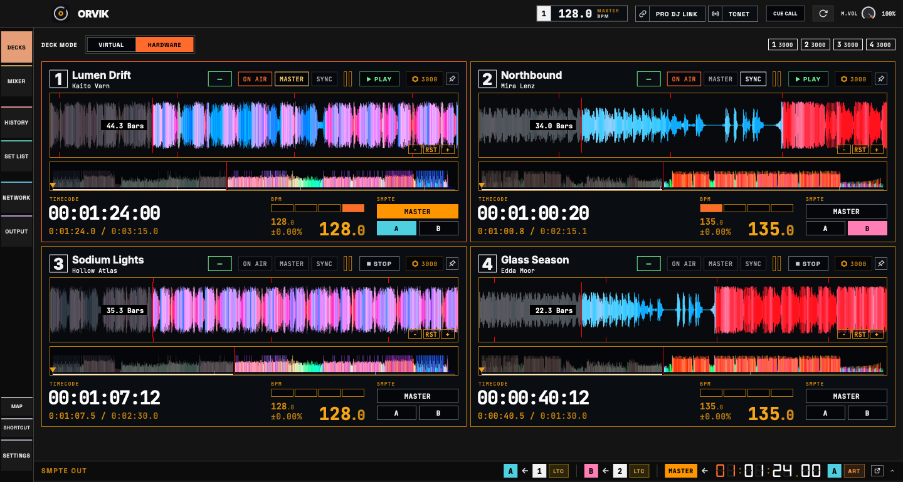
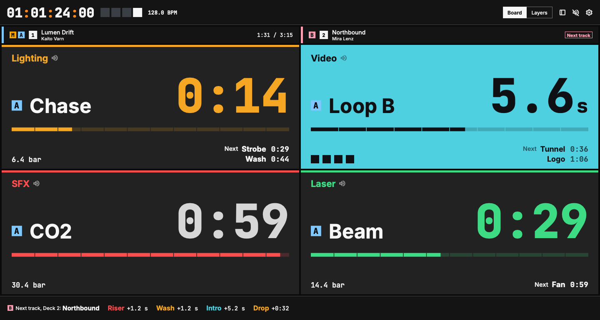
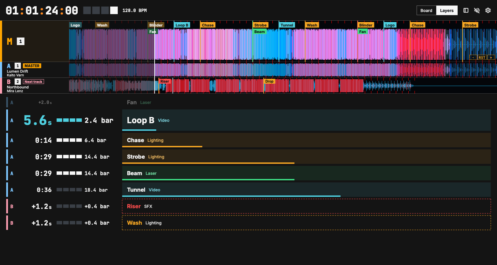
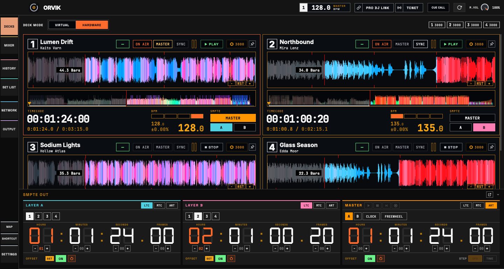
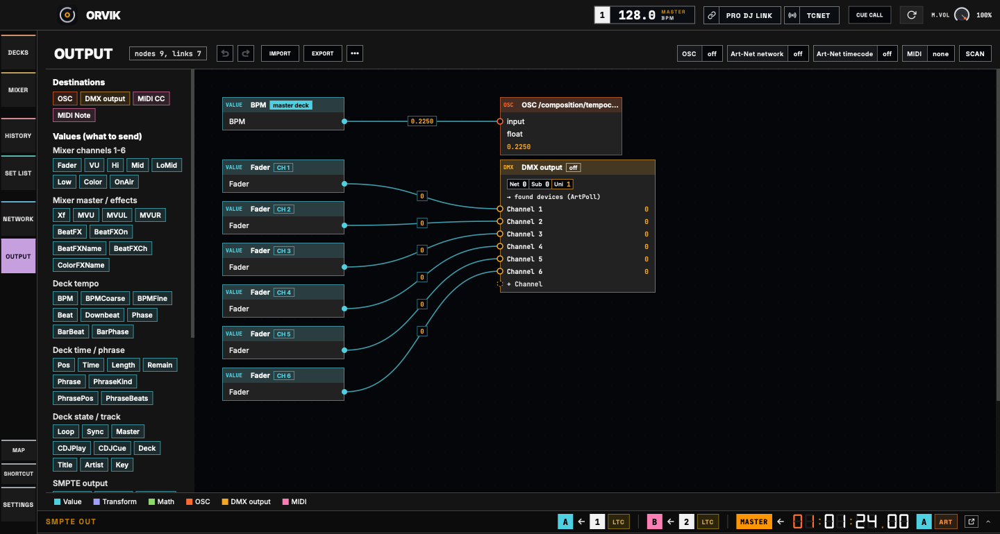
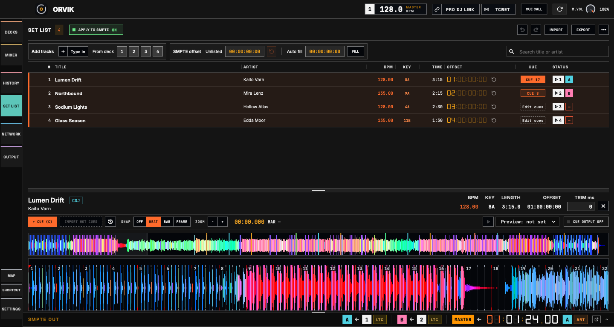
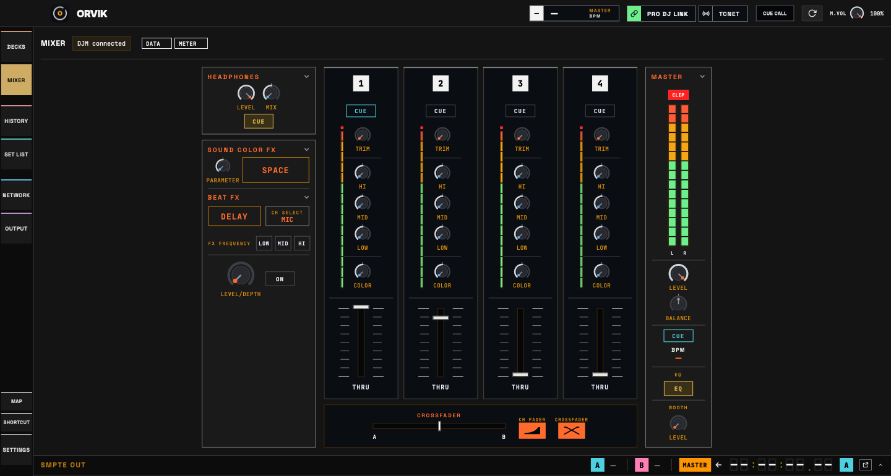

<picture>
  <source media="(prefers-color-scheme: dark)" srcset="docs/media/orvik-wordmark-dark.png">
  
</picture>

**English** | [한국어](README.ko.md)

[Download](https://github.com/Zesminseok/ORVIK/releases/latest) | [Manual](docs/manual/ORVIK-manual-en.md) | [Changelog](CHANGELOG.md) | [Issues](https://github.com/Zesminseok/ORVIK/issues)

## About

ORVIK reads tempo, beat, playback position, track info, cues, waveforms and mixer state from CDJs and DJMs on a PRO DJ LINK network and sends them out as TCNet, SMPTE timecode, OSC, DMX and MIDI.

It only reads the hardware and never controls it.

## Features

- **DECKS**: deck and mixer state, waveforms and cues at a glance
- **SMPTE OUT**: LTC, MTC and Art-Net timecode for layers A, B and MASTER
- **OUTPUT**: a node editor that sends deck and mixer values as OSC, Art-Net / sACN DMX and MIDI
- **SET LIST**: per-track timecode offsets and cues
- **CUE CALL**: next-cue countdown per group, spoken calls and a phone web page
- **SHORTCUT, MAP**: control ORVIK by keyboard, MIDI, OSC and DMX

Also: virtual decks, web viewer, mirror mode, HISTORY and 7 languages.

## Screenshots

<table>
<tr>
<td width="50%"> <b>CUE CALL board</b>: each group's next cue and the time left</td>
<td width="50%"> <b>CUE CALL layers</b>: master deck waveform and cue timeline</td>
</tr>
<tr>
<td width="50%"> <b>SMPTE OUT</b>: timecode for layers A, B and MASTER</td>
<td width="50%"> <b>OUTPUT</b>: node editor for OSC, DMX and MIDI</td>
</tr>
<tr>
<td width="50%"> <b>SET LIST</b>: timecode offsets and the cue editor</td>
<td width="50%"> <b>MIXER</b>: DJM state (DJM-900NXS2)</td>
</tr>
</table>

## Install

Get the file for your system from the [latest release](https://github.com/Zesminseok/ORVIK/releases/latest).

| System | File |
| --- | --- |
| macOS&nbsp;13.3+&nbsp;(Apple&nbsp;Silicon) | `mac-arm64.dmg` |
| Windows&nbsp;10,&nbsp;11&nbsp;(x64) | `win-x64.exe` (portable, no installation) |

1. On macOS, open the DMG and move ORVIK to Applications (notarized by Apple). On Windows, run the `.exe`.
2. Connect the computer and the DJ hardware to the same network.
3. In ORVIK's settings, pick that network interface.

> [!NOTE]
> - There is no Intel Mac build.
> - 1.6 settings are not carried over to 2.0.
> - The Windows file is not code-signed. If SmartScreen warns, choose **More info → Run anyway**.

> [!IMPORTANT]
> Beta. Check timecode and outputs with your actual receivers before a show.

## Compatibility

| | |
| --- | --- |
| Tested&nbsp;hardware | CDJ-3000X, CDJ-3000, CDJ-2000NXS2, DJM-V10, DJM-900NXS2 |
| Receivers | software and hardware that take TCNet, LTC, MTC, Art-Net, OSC, sACN or MIDI |

> [!TIP]
> Hardware not listed here has not been tested yet. What ORVIK can read depends on the model and firmware. 
> If you try other hardware, please report the result in [Issues](https://github.com/Zesminseok/ORVIK/issues).

## Troubleshooting

| Symptom | What to check |
| --- | --- |
| No&nbsp;decks,&nbsp;NO&nbsp;LINK | Pick the CDJs' network as the PRO DJ LINK interface in settings, then press refresh. |
| Nothing&nbsp;found&nbsp;on&nbsp;Windows | Make sure Windows Firewall is not blocking ORVIK. |
| No&nbsp;link&nbsp;with&nbsp;another&nbsp;app | Quit the program ORVIK names, then turn PRO DJ LINK on again. |
| Timecode&nbsp;off&nbsp;on&nbsp;the&nbsp;receiver | Use the same frame rate in ORVIK and on the receiver. |

If that does not help, record a log as described under **Recording a log** below and attach it to an [issue](https://github.com/Zesminseok/ORVIK/issues).

## Privacy and network

ORVIK sends no usage data to the internet.

What ORVIK exchanges on the local network

| Feature | Default | What |
| --- | --- | --- |
| PRO&nbsp;DJ&nbsp;LINK | on | joins as "ORVIK" and requests track info, waveforms, cues, mixer state |
| TCNet | on | sends track info, artwork, position, BPM, mixer values |
| OUTPUT,&nbsp;SMPTE&nbsp;OUT | off | sends OSC, DMX, MIDI and timecode to the targets you set |
| SHORTCUT&nbsp;input | off | receives OSC (UDP 7700) and Art-Net DMX (UDP 6454) |
| Web&nbsp;viewer | off | TCP 8877, 4-character code, unencrypted HTTP |
| Mirror | on | with no CDJ, connects to a mirror server on the network (serving off, TCP 8878) |
| Update&nbsp;check | on | checks GitHub every 12 hours (sends only the app version) |

- Spoken calls are made with the system voices; no text leaves the computer.
- Settings folder: macOS `~/Library/Application Support/com.zesminseok.orvik`, Windows `%APPDATA%\Zesminseok\ORVIK`
- HISTORY and SET LIST start empty at each launch. Export them before quitting to keep them.

Recording a log

1. In the Info section of Settings, press **Option+Shift+A** (Windows **Alt+Shift+A**).
2. Turn on **Log capture** and reproduce the problem.
3. Turn it off when done. It can grow to nearly 1 GB per hour.

Logs can contain track titles, device names, IP and MAC addresses. Check them before attaching to an issue.

## Documentation

- Manual: [English](docs/manual/ORVIK-manual-en.md), [한국어](docs/manual/ORVIK-manual-ko.md), [日本語](docs/manual/ORVIK-manual-ja.md), [Español](docs/manual/ORVIK-manual-es.md), [Deutsch](docs/manual/ORVIK-manual-de.md), [Français](docs/manual/ORVIK-manual-fr.md), [繁體中文](docs/manual/ORVIK-manual-zh-TW.md)
- [Changelog](CHANGELOG.md)
- FFmpeg materials for 1.6.x: [FFmpeg notes](docs/third-party/FFMPEG.md) (2.0 does not use FFmpeg)

## Support

ORVIK is a free beta with no time limit. If you want to support development, you can do so through [GitHub Sponsors](https://github.com/sponsors/zesminseok).

Contributing does not unlock features. A contribution is not a purchase or preorder and does not guarantee a final version or a date.

## Contact

- Bugs and requests: [GitHub Issues](https://github.com/Zesminseok/ORVIK/issues)
- Instagram: [@zes_minseok](https://instagram.com/zes_minseok)

## License

[Application license](BINARY_LICENSE.md), [Documentation license](LICENSE), [Third-party notices](THIRD_PARTY_NOTICES.md)

This repository provides documentation and release files only; the application source code is not public.

ORVIK is an independent compatibility tool, not affiliated with AlphaTheta, Pioneer DJ, TC Supply or Resolume. Product names and trademarks are used only to describe compatibility. Art-Net™ Designed by and Copyright Artistic Licence.
