# ORVIK Benutzerhandbuch (2.0)

Dieses Handbuch beschreibt die Bildschirme von ORVIK und ihre Teile. Die Nummern in den Bildern entsprechen denen in den Listen. Version 2.0 ist eine native App (C++ / JUCE); dieses Handbuch beschreibt die Bildschirme von 2.0.

## Inhalt

1. [Bevor Sie beginnen](#1-bevor-sie-beginnen)
2. [Bildschirmaufbau](#2-bildschirmaufbau)
3. [Kopfzeile](#3-kopfzeile)
4. [Seitenleiste](#4-seitenleiste)
5. [Statusleiste](#5-statusleiste)
6. [DECKS](#6-decks)
7. [SMPTE OUT](#7-smpte-out)
8. [MIXER](#8-mixer)
9. [HISTORY](#9-history)
10. [SET LIST](#10-set-list)
11. [CUE CALL](#11-cue-call)
12. [NETWORK](#12-network)
13. [OUTPUT](#13-output)
14. [SHORTCUT und MAP](#14-shortcut-und-map)
15. [Einstellungen](#15-einstellungen)
16. [Marken und Lizenzen](#16-marken-und-lizenzen)

---

## 1. Bevor Sie beginnen

### Was ORVIK ist

ORVIK empfängt die Wiedergabedaten von CDJ und DJM und gibt sie an Licht- und Videosoftware weiter: TCNet, SMPTE-Timecode (LTC, MTC, Art-Net), OSC, DMX (Art-Net, sACN), MIDI und MIDI Clock. Außerdem kann es der Crew die Cues der Set List in Cue-Call-Fenstern zeigen und sie ansagen. Es fragt die Geräte nur ab; es steuert sie nicht.

**Sicherheit.** ORVIK ist keine Sicherheitseinrichtung. Seine Ausgaben (Timecode, OSC, DMX, MIDI und Cue-Aktionen) können verspätet ankommen, aussetzen oder sich wiederholen, wenn ein Netzwerk, ein Computer oder ein Deck ausfällt. ORVIK darf nichts allein auslösen oder halten, was Menschen verletzen oder Sachen beschädigen kann, etwa Flammen, Pyrotechnik, CO2-Jets, Laser oder bewegte Maschinen. Solche Effekte brauchen eigene Sicherheitssysteme: einen Freigabe- oder Totmannschalter in der Hand einer geschulten Person, einen Not-Halt und die Grenzen, die der Gerätehersteller und die örtlichen Vorschriften setzen. Vor der Show jeden Cue mit den echten Empfängern testen.

### Voraussetzungen

| Punkt | Details |
| --- | --- |
| Betriebssystem | macOS 13.3 oder neuer (Apple Silicon), Windows 10, 11 (x64) |
| Geprüfte Geräte | CDJ-3000X, CDJ-3000, CDJ-2000NXS2, DJM-V10, DJM-900NXS2 |

Welche Daten verfügbar sind, hängt von Gerät, Firmware und Verbindung ab.

### Installation und Start

- **macOS** — DMG öffnen und ORVIK in den Ordner Programme ziehen.
- **Windows** — die heruntergeladene `.exe` direkt starten. Es gibt keinen Installer. Die Datei ist nicht signiert; wenn SmartScreen beim ersten Start warnt, "Weitere Informationen" und dann "Trotzdem ausführen" wählen.

Beim Start und beim Beenden erscheint kurz ein Begrüßungsbild. Beim Beenden werden zuerst die TCNet- und PRO DJ LINK-Verbindungen geschlossen.

### Erste Verbindung

1. Verbinden Sie diesen Rechner mit dem Netz der Player und des Mixers: derselbe Switch oder Router. TCNet an Arena kann über dasselbe Netz oder über einen zweiten Adapter gehen.
2. Starten Sie ORVIK. PRO DJ LINK und TCNET schalten sich von selbst ein (**PRO DJ LINK automatisch starten** und **TCNet automatisch starten** in den [Einstellungen](#15-einstellungen)); sonst schalten Sie sie in der Kopfzeile ein.
3. Die Player erscheinen in DECKS und NETWORK. Mit **Automatische Erkennung** nutzt ORVIK den Adapter, an dem CDJ zu sehen sind; um einen Adapter festzulegen, wählen Sie ihn in den Einstellungen unter **PRO DJ LINK-Schnittstelle**.
4. Erscheint kein Gerät, zeigt NETWORK, was an der Einrichtung nicht stimmt und was zu tun ist. [12.1](#121-warnungen-zur-einrichtung)

Unter macOS erlauben Sie ORVIK unter Systemeinstellungen > Datenschutz & Sicherheit > Lokales Netzwerk. Unter Windows erlauben Sie ORVIK, wenn die Firewall fragt; ein Adapter ohne Router gilt als öffentliches Netz, erlauben Sie daher auch öffentliche Netze.

---

## 2. Bildschirmaufbau

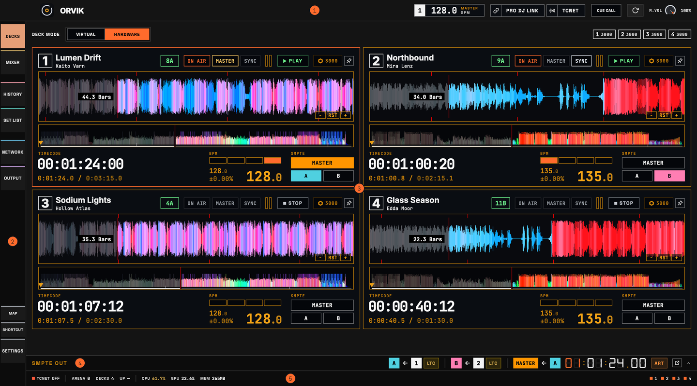

1. **Kopfzeile** — Master-BPM, die Schalter PRO DJ LINK und TCNET, die Schaltfläche CUE CALL, Lautstärke und Fensterschaltflächen. [Kapitel 3](#3-kopfzeile)
2. **Seitenleiste** — wählt die Seite. [Kapitel 4](#4-seitenleiste)
3. **Seite** — der in der Seitenleiste gewählte Bildschirm. Das Bild zeigt DECKS.
4. **SMPTE OUT-Dock** — zeigt und stellt die Timecode-Ausgänge ein. Zum Ausklappen anklicken. [Kapitel 7](#7-smpte-out)
5. **Statusleiste** — Zustand von Übertragung und App. [Kapitel 5](#5-statusleiste)

Ist ein CUE CALL-Fenster angedockt, erscheint das Cue-Call-Panel rechts neben der Seite. [Kapitel 11](#11-cue-call)

---

## 3. Kopfzeile

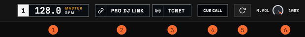

1. **MASTER BPM** — das BPM des CDJ-Masters. Hat der Master kein BPM, wird das eines laufenden Decks gezeigt, zuerst eines, das on air ist. Das linke Feld ist die Player-Nummer des Masters.
2. **PRO DJ LINK** — schaltet die Verbindung zu CDJ und DJM ein und aus.
3. **TCNET** — schaltet die TCNet-Übertragung an die Licht- und Videosoftware ein und aus. Steht der TCNet-Modus in den Einstellungen auf Client, oder ist STANDBY aktiv, wird auch eingeschaltet nichts gesendet.
4. **CUE CALL** — öffnet einen Cue Call, angedockt rechts im Hauptfenster; ein zweiter Klick schließt alle Cue Calls, Alt+Klick (Wahl+Klick auf dem Mac) öffnet einen als eigenes Fenster. Die Schaltfläche bleibt gefüllt, solange ein Cue Call offen ist. [Kapitel 11](#11-cue-call)
5. **Neu laden** — lädt den Bildschirm neu (Cmd/Strg+R). Die Wiedergabe der virtuellen Decks stoppt.
6. **M.VOL** — die Lautstärke des Tons der virtuellen Decks, den die App ausgibt. CDJ- und Mixer-Audio sind davon nicht betroffen.
7. **Fensterschaltflächen** — unter Windows: ORVIK minimieren, maximieren und schließen. Unter macOS dienen die üblichen Schaltflächen oben links im Fenster, und das Menü Fenster enthält Im Dock ablegen (⌘M) und Schließen (⌘W). Gibt es eine ungespeicherte History oder Set List, fragt ORVIK beim Schließen, ob gespeichert werden soll.

### Zustand der Schalter

Ist PRO DJ LINK oder TCNET eingeschaltet, füllt sich das linke Feld mit der Statusfarbe: grün, wenn alles in Ordnung ist, ein blinkender Punkt während des Einschaltens. Gibt es etwas zu prüfen, erscheint eine dieser Beschriftungen im Schalter.

| Beschriftung | Bedeutung |
| --- | --- |
| NO H/W | PRO DJ LINK ist eingeschaltet, aber kein CDJ oder DJM ist zu sehen. |
| LOST | Es gibt Hardware-Decks, aber seit mehr als 1,5 s sendet kein CDJ einen Status. |
| STANDBY | Im selben Netz läuft bereits ein früher gestarteter TCNet-Server; die Übertragung wartet. |

Hindert die Netzwerkeinrichtung Player und Mixer daran, ORVIK zu erreichen, nennt der Tooltip des Schalters PRO DJ LINK das Problem. [12.1](#121-warnungen-zur-einrichtung)

Gibt es eine neue Version, erscheint das Abzeichen UPDATE in der Kopfzeile. Ein Klick öffnet die Download-Seite.

---

## 4. Seitenleiste

| Menü | Inhalt |
| --- | --- |
| DECKS | Wellenformen, Timecode und Wiedergabezustand je Deck |
| MIXER | Kanalfader, EQ und Pegelanzeigen des DJM |
| HISTORY | Protokoll der Titel, die on air waren |
| SET LIST | Set List, Timecode-Offsets je Titel und Cue-Bearbeitung |
| NETWORK | PRO DJ LINK-Geräte, TCNet-Knoten und Warnungen zur Netzwerkeinrichtung |
| OUTPUT | Node-Editor, der Deck- und Mixerwerte als OSC, DMX (Art-Net, sACN) und MIDI sendet, mit den Einstellungen für Art-Net-Netzwerk und Timecode. [Kapitel 13](#13-output) |
| MAP | Schaltet MAP ein und aus: ein Bedienelement auf dem Bildschirm anklicken, dann eine Taste drücken oder MIDI oder DMX senden, um es zuzuweisen. [Kapitel 14](#14-shortcut-und-map) |
| SHORTCUT | Die Eingänge Tastatur, MIDI, OSC und DMX und die Liste der Zuweisungen. [Kapitel 14](#14-shortcut-und-map) |
| SETTINGS | Öffnet das Einstellungsfenster; ein erneuter Klick schließt es. [Kapitel 15](#15-einstellungen) |

Die Menüs sind von oben gruppiert: DECKS und MIXER, HISTORY und SET LIST, NETWORK und OUTPUT. MAP und SHORTCUT liegen unten über SETTINGS.

---

## 5. Statusleiste

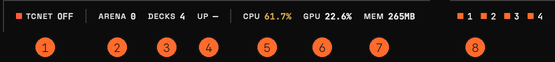

1. **TCNET** — ob der TCNET-Schalter in der Kopfzeile eingeschaltet ist. Bei STANDBY wird trotz ON nichts gesendet.
2. **ARENA** — Anzahl der TCNet-Knoten, die in den letzten 10 s gesehen wurden.
3. **DECKS** — Hardware-Decks plus virtuelle Decks mit geladenem Titel.
4. **UP** — Zeit seit dem Start der Engine.
5. **CPU** — CPU-Auslastung von ORVIK.
6. **GPU** — der Anteil der Grafikkartenzeit, den ORVIK nutzt, sofern das System ihn meldet.
7. **MEM** — Speicher, den ORVIK belegt.
8. **Deck-Punkte** — ein Punkt je Deck. Hardware-Decks zeigen ihre Farbe; virtuelle Decks wechseln die Farbe nach Wiedergabe, Cue, geladen oder leer.

Bei Problemen erscheinen LINK, OUT oder MIX in der Statusleiste: LINK bei doppelten Player-Nummern oder wenn die Netzwerkeinrichtung Aufmerksamkeit braucht (etwa PDJL keine Geräte oder PDJL anderes Subnetz), OUT wenn die TCNet-Übertragung gestoppt ist oder die App spiegelt, MIX wenn die Mixerdaten abgerissen sind. Ein Klick führt zur betreffenden Seite. Solange alles in Ordnung ist, erscheinen sie nicht.

---

## 6. DECKS

### 6.1 Deck-Modus und verbundene Geräte

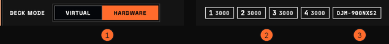

1. **Deck-Modus** — HARDWARE folgt den CDJ im PRO DJ LINK-Netz (Standard). VIRTUAL nutzt virtuelle Decks, die Audiodateien dieses Rechners abspielen. Ein Moduswechsel entfernt die aktuellen Decks; der Wechsel zu HARDWARE mit vorhandenen virtuellen Decks fragt nach. [6.4](#64-virtuelle-decks)
2. **CDJ** — Nummer und Modell jedes verbundenen Players. Mauszeiger darüber zeigt die IP; Rechtsklick wählt die Deckfarbe.
3. **DJM** — Modell des verbundenen Mixers. NO DATA wird angefügt, wenn länger als 1,5 s kein Steuerwert eintrifft.

### 6.2 Deck-Karte

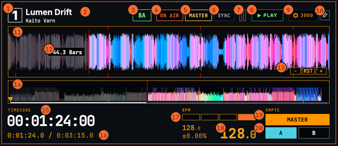

Das Bild zeigt eine Karte im Layout FLOW. Andere Layouts lassen einige Teile weg oder verschieben sie.

1. **Player-Nummer** — Rechtsklick wählt die Deckfarbe.
2. **Titel, Künstler**
3. **Tonart** — die Tonart des Titels in Camelot-Schreibweise wie 8A; nicht umrechenbare werden unverändert gezeigt.
4. **ON AIR** — leuchtet, wenn der Kanal dieses Decks am Mixer on air ist.
5. **MASTER** — leuchtet, wenn dieses Deck der CDJ-Master ist.
6. **SYNC** — leuchtet, wenn Beat Sync aktiv ist.
7. **Kanalfader, Pegelanzeige** — Faderstellung und Kanalpegel am DJM.
8. **Wiedergabezustand** — PLAY, PAUSE, CUE, LOOP usw.
9. **Modell, Medium** — CDJ-Modell und das Medium mit dem Titel (Player-Nummer und USB oder SD). Die Chipfarbe ist die in rekordbox gesetzte Medienfarbe; ohne Farbe grau. Ohne Farbinformation steht Text statt des Chips.
10. **Groß fixieren** — hält in FLOW dieses Deck groß. Erneut klicken oder einen anderen Titel laden löst es.
11. **Detail-Wellenform** — die Wellenform um die Wiedergabeposition. Die rote Linie ist die Position.
12. **Taktzähler** — Takte bis zum nächsten Memory-Cue. Ab 8 oder weniger rot; ohne Cue voraus zeigt er die vergangenen Takte. Klick wechselt auf Sekunden.
13. **Zoom** — − vergrößert die Ansicht (×2 je Klick), + verkleinert sie (mindestens 0,5 s). RST stellt die Standardansicht von 8 s wieder her.
14. **Gesamt-Wellenform** — der ganze Titel. Bei Hardware-Decks zeigt Gedrückthalten die Detail-Wellenform an dieser Stelle; Loslassen kehrt zurück. Während der Vorschau zeigt der Zähler den Abstand zur Wiedergabeposition in Sekunden oder Minuten:Sekunden.
15. **Timecode** — der Timecode der aktuellen Position.
16. **Zeit** — Klick wechselt zwischen vergangener und verbleibender Zeit. Rechts die Gesamtlänge.
17. **Beat-Position** — welcher Beat im Takt spielt.
18. **BPM** — oben links das Original-BPM, darunter die Tempoänderung (%), die große Zahl rechts das aktuelle BPM.
19. **SMPTE MASTER** — weist dieses Deck Layer A oder B zu und macht diesen Layer zur MASTER-Quelle. Erneut klicken löst nur die MASTER-Quelle; die A-, B-Zuweisung bleibt. Die Ausgänge LTC, MTC und Art-Net werden in SMPTE OUT getrennt eingeschaltet.
20. **SMPTE A, B** — macht dieses Deck zur Quelle von SMPTE-Layer A oder B.

Steht die Wellenformfarbe auf 3band und der Titel hat keine 3band-Daten, erscheint ! am Deck und die Wellenform wird in RGB gezeigt. Wellenformen werden auf der Grafikkarte (GPU) gezeichnet.

### 6.3 Layouts

Es gibt vier Deck-Layouts. Wählen Sie mit **Layout-Thema** in den [Einstellungen](#15-einstellungen).

<table>
<tr>
<td width="50%">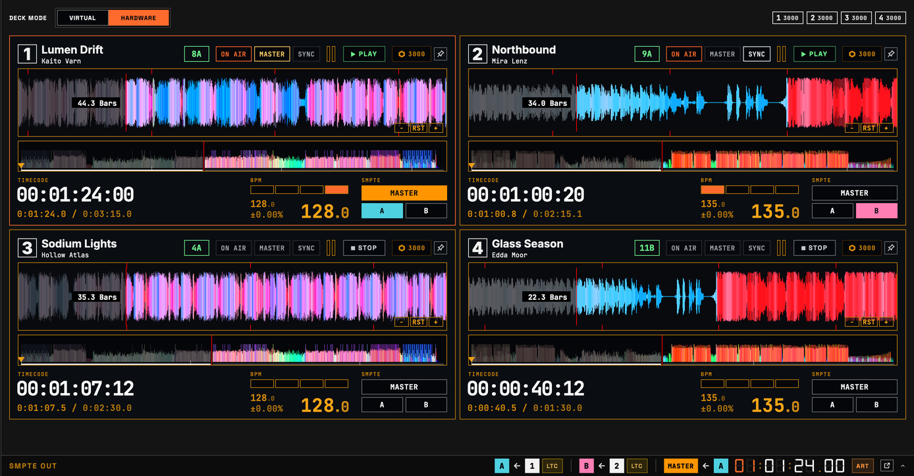 <b>FLOW</b> — passt die Deckgröße nach CDJ-Master, On-Air und Wiedergabe an. In einem breiten Fenster werden bis zu vier geladene Decks groß gezeigt.</td>
<td width="50%">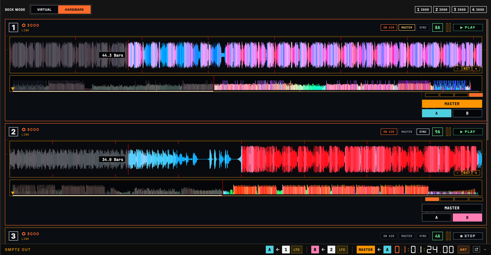 <b>STK</b> — stapelt alle Decks als gleich große Karten, je zwei nebeneinander.</td>
</tr>
<tr>
<td>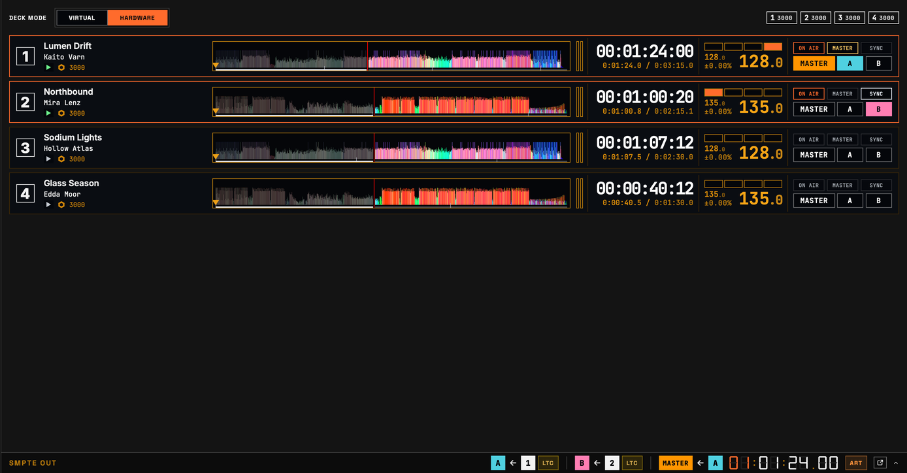 <b>STRIP</b> — eine schmale Zeile je Deck. Nur die Gesamt-Wellenform wird gezeigt.</td>
<td>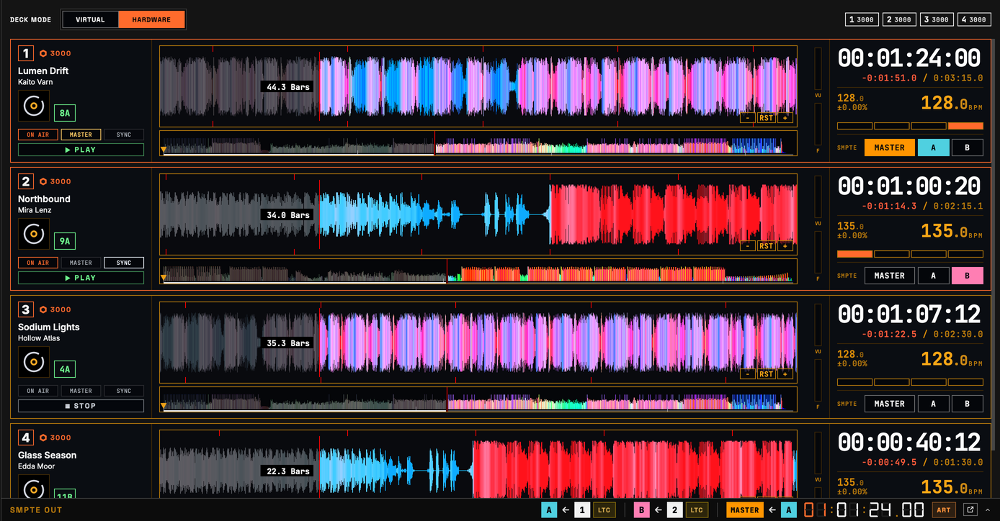 <b>ROW</b> — eine Reihe je Deck mit breiten Detail- und Gesamt-Wellenformen.</td>
</tr>
</table>

### 6.4 Virtuelle Decks

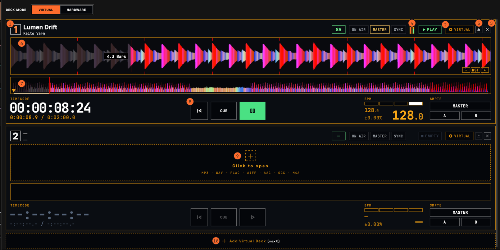

Steht der Deck-Modus auf VIRTUAL, spielen virtuelle Decks Audiodateien dieses Rechners ab. Sie nutzen unabhängig vom Layout-Thema immer die FLOW-Karte, mit den Transportschaltflächen (⑧) zwischen Timecode und BPM. Das Bild zeigt ein Deck mit Titel und ein leeres Deck.

1. **Deck-Nummer**
2. **VIRTUAL** — kennzeichnet ein virtuelles Deck, das eine Datei dieses Rechners abspielt.
3. **×** — entfernt dieses virtuelle Deck.
4. **Kanalfader** — zum Einstellen ziehen.
5. **Auswerfen** — entlädt den Titel.
6. **Detail-Wellenform** — ziehen verschiebt die Position.
7. **Gesamt-Wellenform** — klicken oder ziehen verschiebt die Position.
8. **|◀, CUE, ▶** — CUE setzt in Pause den Cue-Punkt und spielt, solange es gehalten wird; bei Wiedergabe springt es zum Cue-Punkt zurück. ▶ spielt und pausiert; |◀ stoppt und springt an den Anfang.
9. **Öffnen** — Klick wählt eine Audiodatei, oder eine Datei hierher ziehen.
10. **Virtuelles Deck hinzufügen** — fügt ein weiteres virtuelles Deck hinzu, bis zu 6.

Unterstützte Dateien: MP3, WAV, AIFF, FLAC, AAC, M4A (AAC, ALAC), OGG, MP4 (Audio). Jedes Format, das ein CDJ öffnet, öffnet sich auch hier.

Der Ton der virtuellen Decks kommt aus dem unter **Audio-Ausgang** in den [Einstellungen](#15-einstellungen) gewählten Gerät; die Lautstärke ist M.VOL in der Kopfzeile.

---

## 7. SMPTE OUT

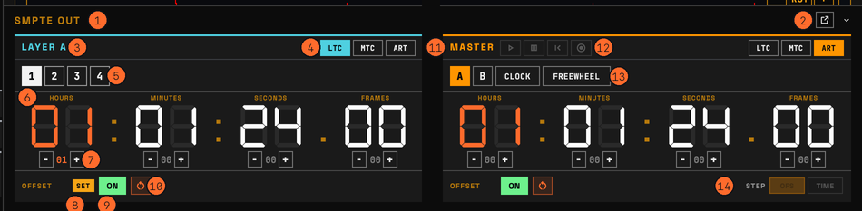

Es gibt drei Timecode-Ausgangslayer: A, B und MASTER. Layer A und B senden die Position des gewählten Decks; MASTER sendet Layer A, Layer B, die Rechneruhr oder FREEWHEEL. Das Bild zeigt Layer A und MASTER; Layer B entspricht A.

1. **SMPTE OUT** — Klick klappt das Dock aus oder ein. Eingeklappt zeigt es jeden Layer mit seiner Verbindung und dann die eingeschalteten Ausgänge: A ← 1 heißt, Layer A folgt Deck 1, MASTER ← A heißt, MASTER sendet Layer A; danach folgt der MASTER-Timecode.
2. **Abtrennen** — öffnet SMPTE OUT in einem eigenen Fenster. Beim Schließen kehrt es ins Dock zurück.
3. **Layer A** — der Layer, der die Position des gewählten Decks als Timecode sendet. Layer B ist gleich.
4. **LTC, MTC, ART** — schaltet die Ausgänge LTC (Audio-Timecode), MTC (MIDI-Timecode) und ART (Art-Net-Timecode) dieses Layers ein und aus. LTC kann in jedem Layer aktiv sein, MTC und ART jeweils nur in einem (Einschalten in einem Layer schaltet sie in den anderen aus). LTC-Gerät und MTC-Port werden unter **SMPTE-Timecode-Ausgang** in den [Einstellungen](#15-einstellungen) gewählt, das Art-Net-Netzwerk oben auf der Seite [OUTPUT](#13-output). Der Art-Net-Timecode nutzt die **Bildrate** von SMPTE.
5. **Quell-Deck** — das Deck, dem dieser Layer folgt. Entspricht den Schaltflächen A, B auf der Karte.
6. **Timecode** — die Position der Quelle plus Offset. Auf die tatsächliche Ausgabe kommt noch der **Latenzausgleich** aus den Einstellungen.
7. **− / +** — ändert jedes Feld um 1; mit Strg (Cmd am Mac) um 10. Steht STEP von MASTER auf TIME, ändert es die FREEWHEEL-Zeit, sonst den Offset.
8. **SET** — zeigt, dass der Offset der Set List in diesen Layer geladen ist. Mauszeiger darüber zeigt den Titel. Beim Offset UNLISTED, weil der Titel nicht in der Liste steht, steht SET —.
9. **OFFSET ON** — nimmt den Offset in die Ausgabe auf oder lässt ihn weg. Der Wert bleibt erhalten.
10. **Zurücksetzen** — setzt den Offset auf 0.
11. **MASTER** — der MASTER-Layer.
12. **FREEWHEEL-Schaltflächen** — ▶ lässt den FREEWHEEL-Code laufen, ❚❚ pausiert ihn und behält den Wert, |◀ kehrt zu 00:00:00:00 zurück. READY (◉) hält FREEWHEEL beim aktuellen Wert und startet ihn, sobald ein Deck zu spielen beginnt. Mit Mixer zählen nur Decks, die in dem Moment on air sind; bereits laufende und CUE-Vorhören nicht.
13. **Quelle** — A und B senden den Code dieses Layers plus MASTER-Offset. CLOCK nutzt die Rechnerzeit; FREEWHEEL läuft eigenständig ab dem letzten MASTER-Wert weiter.
14. **STEP** — bei MASTER-Quelle FREEWHEEL, ob − / + den Offset (OFS) oder die FREEWHEEL-Zeit (TIME) ändert.

Ist **LTC im Stopp halten** in den Einstellungen eingeschaltet (Standard), sendet LTC bei gestopptem Deck weiter den Code der gestoppten Position, dasselbe Frame wiederholt, damit der Empfänger den Stopp erkennt. Ausgeschaltet schweigt LTC, solange das Deck steht.

---

## 8. MIXER

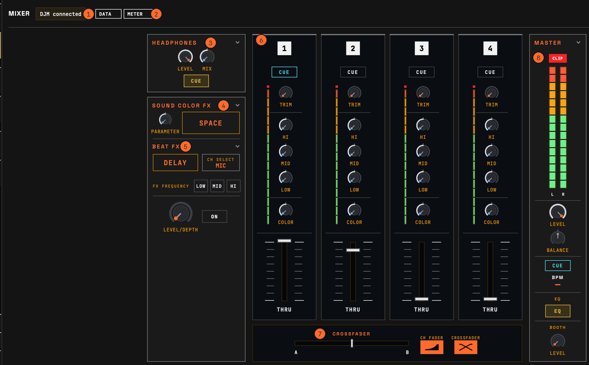

Zeigt den Zustand, den der DJM sendet. ORVIK ändert keine Mixereinstellungen. Kanalzahl und einige Elemente hängen vom Modell ab.

1. **DJM-Verbindung** — ob der DJM zu sehen ist.
2. **DATA, METER** — DATA: Steuerwerte (Fader, EQ) kommen an; METER: Pegelwerte kommen an.
3. **HEADPHONES** — Kopfhörerbereich. [8.1](#81-kopfhörer-und-effekte)
4. **SOUND COLOR FX** — Sound-Color-FX-Bereich. [8.1](#81-kopfhörer-und-effekte)
5. **BEAT FX** — Beat-FX-Bereich. [8.1](#81-kopfhörer-und-effekte)
6. **Kanäle** — ein gleicher Bereich je Kanal. [8.2](#82-kanäle)
7. **Crossfader** — Crossfaderstellung und die Kurven CH FADER und CROSSFADER.
8. **MASTER** — Master-Bereich. [8.3](#83-master)

<table>
<tr>
<td align="center">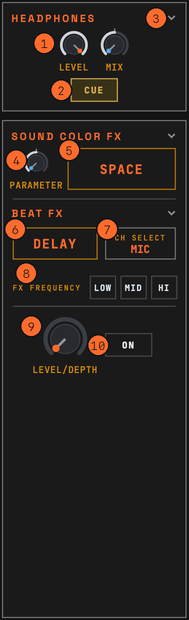 8.1 Kopfhörer und Effekte</td>
<td align="center">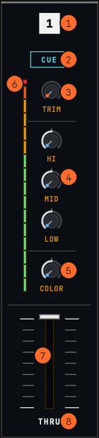 8.2 Kanäle</td>
<td align="center">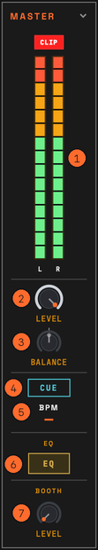 8.3 MASTER</td>
</tr>
</table>

### 8.1 Kopfhörer und Effekte

1. **LEVEL, MIX** — Stellung von Kopfhörer-LEVEL und CUE/Master-Balance (MIX).
2. **CUE** — leuchtet, wenn der Master im Kopfhörer zu hören ist.
3. **Einklappen** — Klick auf den Bereichsnamen klappt ihn ein oder aus.
4. **PARAMETER** — Stellung des PARAMETER von SOUND COLOR FX.
5. **SOUND COLOR FX-Effekt** — der gewählte Effekt; OFF, wenn keiner.
6. **BEAT FX-Effekt** — der gewählte Effekt.
7. **CH SELECT** — Kanal, auf den BEAT FX wirkt.
8. **FX FREQUENCY** — Band (LOW, MID, HI), auf das BEAT FX wirkt.
9. **LEVEL/DEPTH** — Stellung von LEVEL/DEPTH des BEAT FX.
10. **ON** — leuchtet, wenn BEAT FX aktiv ist.

Bei DJM mit zwei Kopfhörerausgängen werden zusätzlich LEVEL, MIX und LINK CUE von Kopfhörer B gezeigt. LINK CUE leuchtet beim Vorhören des LINK MONITOR von rekordbox.

Bei DJM mit FILTER-Bereich werden der gewählte Filter (LPF, HPF) und die RESONANCE-Stellung gezeigt.

### 8.2 Kanäle

1. **ON AIR** — leuchtet, wenn dieser Kanal on air ist.
2. **CUE, A, B** — Kopfhörer-CUE-Zustand des Kanals. Mit zwei Kopfhörern erscheinen A und B getrennt.
3. **TRIM** — TRIM-Stellung.
4. **EQ** — Stellungen von HI, HI MID, LOW MID und LOW. Die Zahl der Bänder hängt vom Modell ab.
5. **COLOR** — SOUND COLOR FX-Stellung.
6. **Pegelanzeige** — Kanalpegel. CLIP oben leuchtet bei übersteuertem Eingang.
7. **Kanalfader** — Faderstellung.
8. **Crossfader-Zuweisung** — A, THRU oder B für diesen Kanal.

### 8.3 MASTER

1. **Master-Anzeige** — Masterpegel L, R. CLIP leuchtet bei übersteuertem Ausgang.
2. **LEVEL** — Stellung von MASTER LEVEL.
3. **BALANCE** — Stellung von MASTER BALANCE. C ist die Mitte.
4. **CUE** — leuchtet, wenn der Master im Kopfhörer zu hören ist.
5. **BPM** — BPM eines laufenden CDJ. Bei mehreren das des Decks mit der niedrigsten Nummer.
6. **EQ, ISO** — Zustand des Master-EQ. Wechselt zu ISO bei aktivem MASTER ISOLATOR.
7. **BOOTH LEVEL** — Stellung von BOOTH LEVEL.

---

## 9. HISTORY

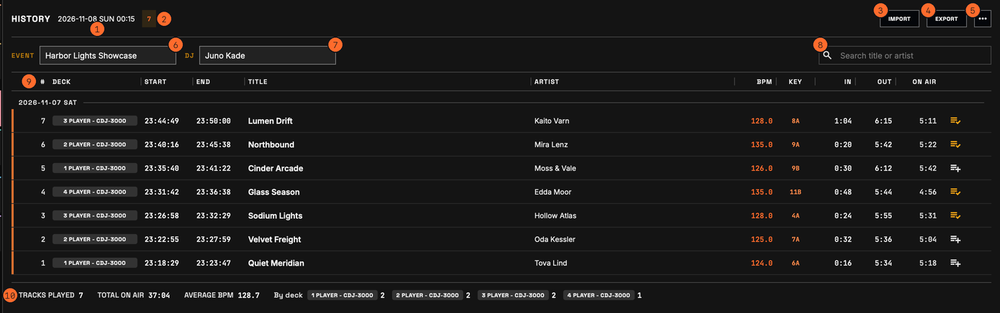

Protokolliert die Titel, die on air waren, mit Uhrzeit und Deck-Nummer. Mit Mixer zählt die Zeit in Wiedergabe und on air; ohne Mixer die Wiedergabezeit. Ein Titel wird nach 10 s protokolliert. Wird Wiedergabe oder On-Air länger als 3 s unterbrochen und kommt zurück, bekommt derselbe Titel eine neue Zeile; unter 3 s läuft dieselbe weiter. Virtuelle Decks werden beim Laden des Titels protokolliert und die Wiedergabezeit gezählt. Der Titel on air zeigt LIVE unter END.

Das Protokoll beginnt bei jedem Start neu. Es wird automatisch gesichert, und nach einem abnormalen Ende fragt ORVIK beim nächsten Start, ob es fortgesetzt werden soll.

1. **Startzeit** — Datum und Uhrzeit, zu der dieses Protokoll begann.
2. **Titelanzahl** — protokollierte Titel.
3. **IMPORT** — lädt eine History-Datei (ORVIK-CSV, ShowKontrol-History-CSV oder -TXT) in das aktuelle Protokoll. Die Einträge werden unverändert angefügt.
4. **EXPORT** — speichert im gewählten Format: ORVIK-CSV (in ORVIK wieder ladbar), ShowKontrol-History, ShowKontrol-Set-List oder Titelliste als TXT.
5. **⋯** — **Autospeicher-Verlauf…** holt eine frühere Kopie des Protokolls zurück ([Autospeicher](#autospeicher-verlauf)); **Ganzen Verlauf löschen…** leert es nach Rückfrage.
6. **EVENT** — Name der Veranstaltung. Geht in die Dateinamen der Exporte (CSV, Set List, Titelliste) und in den Text der TXT.
7. **DJ** — Name des DJ. Geht in den Text der TXT.
8. **Suche** — sucht nach Titel oder Künstler.
9. **Tabellenkopf** — Rand ziehen ändert die Breite; Doppelklick stellt sie zurück. Spalten:
   - **DECK** — Player-Nummer und Modell.
   - **START, END** — wann der Titel on air ging und wann nicht mehr.
   - **IN, OUT** — Wiedergabepositionen beim Gehen on air und beim Verlassen.
   - **ON AIR** — Zeit on air.
10. **Summen** — gespielte Titel, Gesamtzeit ON AIR, mittleres BPM und Titel je Deck.

Die Schaltfläche am rechten Ende einer Zeile fügt den Titel zur Set List hinzu; steht er in der Liste, wird sie orange mit Häkchen (ein erneuter Klick fügt ihn noch einmal hinzu). Beim Überfahren einer Zeile erscheint daneben ein ×, das die Zeile löscht. Beide reagieren auf einen Linksklick. Das Löschen des Titels on air beendet seine Protokollierung, solange er weiterläuft. Auf einem Touchscreen scrollen Sie die Liste durch Ziehen mit dem Finger.

### Autospeicher-Verlauf

ORVIK legt Kopien von History, Set List, Cues und OUTPUT-Nodes an: eine 5 Minuten nach einer Änderung, eine vor dem Leeren, Importieren oder Laden einer Datei und eine beim Beenden von ORVIK. **⋯ > Autospeicher-Verlauf…** auf jeder Seite listet sie auf, die neueste zuerst, mit Uhrzeit, Anlass und Inhalt (Titel, Cues, Zeilen, Nodes). **Wiederherstellen** holt die gewählte Kopie zurück; der aktuelle Stand wird vorher kopiert, sodass Sie zu ihm zurückkehren können. **Ordner öffnen** zeigt die Kopien im Dateimanager.

---

## 10. SET LIST

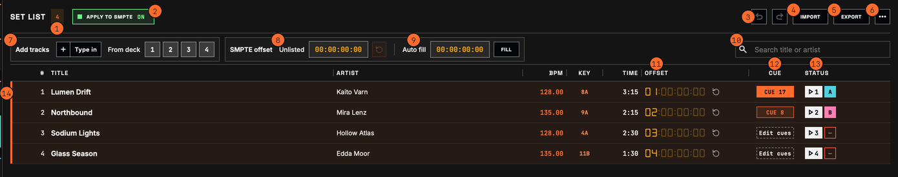

Eine Liste mit Timecode-Offset und Cues für jeden Titel. Bei eingeschaltetem APPLY TO SMPTE geht beim Laden eines Listentitels in ein Deck sein Offset in den SMPTE-Layer (A, B), mit dem dieses Deck verbunden ist. Wie die History ist die Set List bei jedem Start leer; sie wird automatisch gesichert und behält [Autospeicher-Kopien](#autospeicher-verlauf).

1. **Titelanzahl** — Titel in der Liste.
2. **APPLY TO SMPTE** — ein: der Offset eines Listentitels, der in ein Deck geladen ist, geht in den Layer dieses Decks; ein laufendes Deck wechselt sofort. Aus: die Layer-Offsets behalten ihre Werte.
3. **Rückgängig, Wiederholen** — macht Änderungen an der Liste rückgängig und wiederholt sie: Strg+Z (Cmd+Z am Mac) sowie Strg+Umschalt+Z oder Strg+Y (Cmd+Umschalt+Z am Mac).
4. **IMPORT** — lädt eine Set List: eine ORVIK-Datei (.json), eine ShowKontrol-Set-List (.set) oder -History (.csv), eine aus rekordbox exportierte Textliste (.txt) oder Audiodateien. Bei vorhandener Liste fragt es, ob sie ersetzt (Ersetzen) oder ergänzt (Hinzufügen) werden soll, und bittet um Spaltenwahl, wenn es die Spaltennamen einer Textdatei nicht erkennt. ORVIK-Dateien enthalten auch die Cues.
5. **EXPORT** — speichert eine ORVIK-Set-List (mit dem Offset für nicht gelistete Titel und den Cues) oder eine ShowKontrol-Set-List (.set: Titel, Künstler, Offset, Länge).
6. **⋯** — **Gespielt-Markierungen löschen**; **Autospeicher-Verlauf…** holt eine frühere Kopie der Liste zurück; **Ganze Liste löschen…** entfernt nach Rückfrage alle Titel (Rückgängig stellt sie wieder her). Die Cues der Titel werden mit ihnen gelöscht.
7. **Titel hinzufügen** — **Eingeben** fügt einen eingetippten Titel hinzu: Titel, Künstler, dann Offset; Enter springt zum nächsten Feld. **Vom Deck** mit einer Decknummer fügt den in diesem Deck geladenen Titel hinzu.
8. **Nicht gelistet** — der Offset für Titel, die nicht in der Liste stehen. Die Schaltfläche daneben setzt ihn auf 00:00:00:00. Wählen Sie einen Bereich ohne Cues, etwa 23:00:00:00.
9. **Auto-Füllen** — eine Startzeit eingeben und **FILL** klicken, um allen Titeln in Listenreihenfolge einen Offset im Abstand von einer Stunde zu geben. Jeder Offset bleibt bearbeitbar.
10. **Suche** — sucht nach Titel oder Künstler.
11. **OFFSET** — Offset dieses Titels. Klick bearbeitet ihn (HH:MM:SS:FF, unter 24 Stunden); die Schaltfläche daneben setzt ihn auf 00:00:00:00.
12. **CUE** — die Zahl der Cues des Titels oder **Bearbeiten**, wenn er keine hat. Ein Klick darauf oder ein Doppelklick auf den Titel öffnet den Cue-Editor unter der Liste. [10.1](#101-cue-bearbeitung)
13. **STATUS** — ▶ und die Deck-Nummer, solange der Titel in einem Deck liegt, dann der Layer (A, B), der seinen Offset erhielt; ein Strich, wenn dieses Deck keinen Layer speist. Wurde der Titel bei eingeschaltetem APPLY TO SMPTE gespielt und war on air, erscheint ein Häkchen und die Zeile wird abgedunkelt. Ohne Mixer zählt nur die Wiedergabe. Steht derselbe Titel mehrmals in der Liste, wird der Offset einer Zeile ohne Häkchen genommen; steht er einmal, wird der Offset dieser Zeile beim erneuten Abspielen wiederverwendet.
14. **Titel in einem Deck** — Zeilen geladener Titel sind links mit einem Balken markiert.

Klick auf Titel, Künstler oder Offset bearbeitet ihn. Eine Zeile am Griff ziehen ändert die Reihenfolge; der Papierkorb am rechten Ende der Zeile entfernt den Titel. Rand im Tabellenkopf ziehen ändert die Breite; Doppelklick stellt sie zurück. Auf einem Touchscreen scrollen Sie die Liste durch Ziehen mit dem Finger.

### 10.1 Cue-Bearbeitung

Der Cue-Editor öffnet sich unter der Liste auf der Seite SET LIST, mit der Cue-Liste des Titels neben dem Fenster. Beim Wählen eines Titels erscheinen seine Wellenform und seine Cues.

<table>
<tr>
<td width="72%">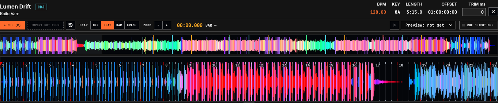 Der Cue-Editor: + CUE (C), HOT CUES ÜBERNEHMEN, Raster, Zoom, Vorhören, CUE-AUSGABE, der ganze Titel und der vergrößerte Ausschnitt.</td>
<td width="28%">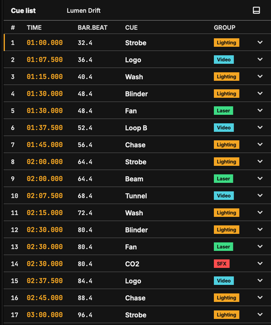 Die Cue-Liste: Zeit, Takt.Beat, Cue und Gruppe.</td>
</tr>
</table>

- **Wellenform** — der ganze Titel und ein vergrößerter Ausschnitt, mit Beatgrid, Taktnummern, Phrasenbändern und Cue-Markierungen. Die Wellenform stammt aus der Audiodatei, dem HISTORY-Protokoll oder vom CDJ, je nachdem, was vorhanden ist. CDJ-Wellenformen brauchen die eingeschaltete Track-Bibliothek (der Editor bietet das Einschalten an). Ohne Wellenform werden Cues nur nach Zeit gesetzt.
- **Position bewegen** — Klick in die Wellenform bewegt die Bearbeitungsposition. **Raster** (aus, Beat, Takt, Frame) lässt sie einrasten. **Zoom** ändert den vergrößerten Bereich.
- **+ Cue (C)** — erzeugt einen Cue an der Bearbeitungsposition. Mit Audiodatei wird diese Stelle vorgehört.
- **Hot Cues übernehmen** — holt Hot Cues und Memory-Punkte aus rekordbox als Cue-Positionen.
- **Cue-Liste** — Zeit, Takt.Beat, Name, Gruppe und Aktionsübersicht.
- **Cue-Einstellungen** — Name, Zeit, Takt.Beat, Gruppe, Vorwarnung (Standard oder eine Anzahl Beats), Stimme (Gruppe folgen, ja, nein), Sprechtext (leer: der Cue-Name) und Aktionsliste.
- **Aktionsliste** — wird von oben nach unten ausgeführt: OSC (Ziel, Adresse, Typ i/f/s, Wert), Art-Net DMX (Universum, mehrere Kanal=Wert), MIDI (Gerät, Kanal, Note on/off, CC, Program) und Warten (ms, oder Beats und Takte). Die Zielliste ist dieselbe wie in OUTPUT.
- **Gruppe** — die Crew-Gruppe des Cues. Die Standardgruppen sind Licht, Video, SFX und Laser; **Gruppen bearbeiten…** im Gruppenmenü benennt sie um, färbt sie oder fügt welche hinzu. Die Gruppen bestimmen das Cue-Call-Fenster und die Sprachausgaben.
- **Cue-Ausgabe** — der Schalter über dem Editor schaltet das Senden der Aktionen ein und aus.

Cues reagieren nur auf den Titel, der im Master-Deck läuft. Steht dieser Titel nicht in der Set List, wird kein Cue gesendet. Der Beat des Cues wird aus Beatgrid und Wiedergabeposition berechnet. Cues gehören zum Set-List-Eintrag, derselbe Titel hat also in jeder Set List andere Cues.

Cue-Aktionen, die Effekte erreichen, die Menschen verletzen können (Flammen, CO2, Pyrotechnik, Laser), müssen über das Sicherheitssystem dieses Effekts laufen. Siehe **Sicherheit** in Abschnitt 1.

---

## 11. CUE CALL

Der Cue Call zeigt die Set-List-Cues des Titels eines Decks nach Crew-Gruppe und zählt bis zum jeweils nächsten Cue herunter. Klicken Sie in der Kopfzeile auf CUE CALL: Ein Cue Call öffnet sich rechts im Hauptfenster angedockt. Ein erneuter Klick auf CUE CALL schließt alle Cue Calls. Alt+Klick (Option+Klick am Mac) öffnet einen weiteren als eigenes Fenster, etwa einen für Licht und einen für SFX. Jeder merkt sich Position, Größe und Anzeigeeinstellungen, und die beim Beenden von ORVIK offenen erscheinen beim nächsten Start wieder.

### Öffnen und Andocken

- **Andocken** — die Schaltfläche links neben dem Lautsprecher in der Kopfzeile des Cue Calls dockt die Ansicht rechts am Hauptfenster an oder öffnet sie wieder als eigenes Fenster. Ein Doppelklick auf die Kopfzeile bewirkt dasselbe.
- **Ziehen** — die Kopfzeile (oder die Titelleiste des Fensters) ziehen verschiebt ein Cue-Call-Fenster. Am rechten Rand des Hauptfensters abgelegt, dockt es dort an. Bis zu zwei Panels teilen sich übereinander die rechte Seite; den Trenner ziehen ändert ihre Breite.
- **Menü Fenster** — unter macOS steht jedes Cue-Call-Fenster im Menü Fenster und im Dock-Menü. Fenster > Schließen (⌘W) schließt das vorderste Cue-Call-Fenster.

Der Fenstertitel nennt die gezeigten Gruppen: "Cue-Ansage (Alle)" oder die Gruppennamen.

### Welchem Deck er folgt

**Folgendes Deck** im Einstellungsfenster wählt das Deck für alle Cue-Call-Fenster und für die gesprochenen Ansagen:

- **SMPTE-Master** — das Deck hinter dem MASTER-Layer von SMPTE OUT: MASTER ← A oder B, dann das Deck dieses Layers (Standard). Läuft MASTER auf CLOCK oder FREEWHEEL, der CDJ-Tempo-Master.
- **Tempo-Master** — der CDJ-Master.
- **ON-AIR-Deck (automatisch)** — das Deck, das gerade zu hören ist, gewählt nach Wiedergabe, Fader und Restzeit, so wie das Layout FLOW sein Hauptdeck wählt. Es kann wechseln, bevor der DJ MASTER drückt.

Ohne ein solches Deck zeigt die Ansicht "Kein Master-Deck"; steht sein Titel nicht in der Set List, "Nicht in der Setlist"; hat der Titel keine Cues, "Dieser Track hat keine Cues."

### Kopfzeile

- **Timecode** — der MASTER-Timecode von SMPTE OUT.
- **Beat-Felder** — vier Felder; der laufende Beat im Takt leuchtet, der erste in Orange.
- **BPM** — das BPM des verfolgten Decks.
- **Titel, Künstler** — der verfolgte Titel, sofern Layer-Leiste oder Spuren ihn nicht schon zeigen.
- **Board, Ebenen** — wechselt das Thema. In einem Fenster unter 600 px Breite liegt es stattdessen im Einstellungsfenster.
- **Andocken, Lautsprecher, Zahnrad** — andocken oder lösen, gesprochene Ansagen ein und aus, das Einstellungsfenster.

### Themen

- **Board** — die Layer-Leiste oben zeigt die Layer A und B mit Deck-Nummer, Titel und Spielzeit; M markiert den Layer, dem MASTER folgt, und das Deck des anderen Layers trägt die Marke Nächster Track. Darunter gibt es eine Karte je Gruppe: Gruppenname, Name des nächsten Cues, große Rückwärtszählung, Takte.Beats und ein Fortschrittsbalken, unten rechts die folgenden Cues der Gruppe. Nähert sich der Cue, füllt sich die Karte mit der Gruppenfarbe; beim Cue zeigt sie GO. Eine Gruppe ohne Cue im aktuellen Titel erhält eine kurze Karte, und die Gruppen mit Cues teilen sich den Platz. Die Leiste unten zeigt den nächsten Titel (das Deck auf dem anderen Layer) und seine ersten Cues, gerechnet ab seiner Position.
- **Ebenen** — drei Spuren und eine Countdown-Liste. Die MASTER-Spur zeigt die nach links laufende Wellenform des verfolgten Decks mit Cue-Markierungen und Namen der gezeigten Gruppen; die NOW-Linie liegt bei 20 % der Breite, und ein Cue ist erreicht, wenn er NOW berührt. Die Spuren A und B zeigen das Deck jedes SMPTE-Layers; das Deck des anderen Layers ist der nächste Titel, mit seinen Cues. Ein Loop erscheint auf der Spur seines Decks wie in der Detail-Wellenform, blasser, solange er gesetzt, aber aus ist. Das Beatgrid folgt **Beatgrid: Detail** in den [Einstellungen](#15-einstellungen). Die Liste darunter hat eine Zeile je kommendem Cue: Layer, Name, Restzeit, Takte.Beats und ein Balken, der in der letzten Minute schrumpft.

Im Thema Ebenen zeigen − und + unten rechts in der MASTER-Spur mehr oder weniger vom Titel, und RST kehrt zum automatischen Bereich zurück. Auch Mausrad oder Zwei-Finger-Zoom über einer Spur zoomen.

<table>
<tr>
<td width="50%">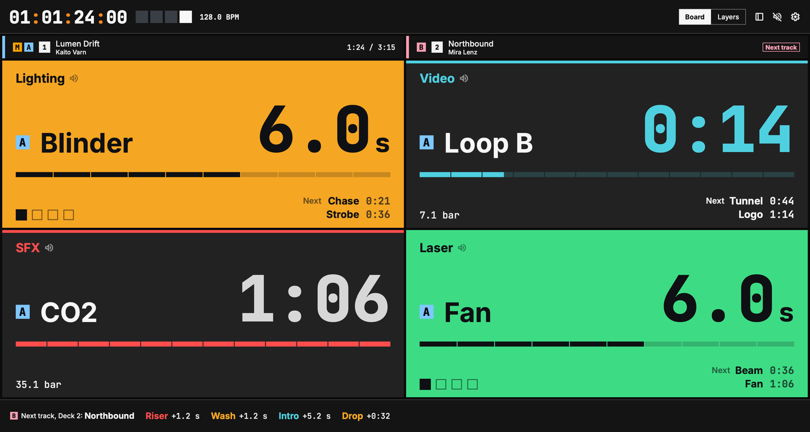 <b>Board</b>, eine Karte je Gruppe mit der Rückwärtszählung bis zu ihrem nächsten Cue.</td>
<td width="50%">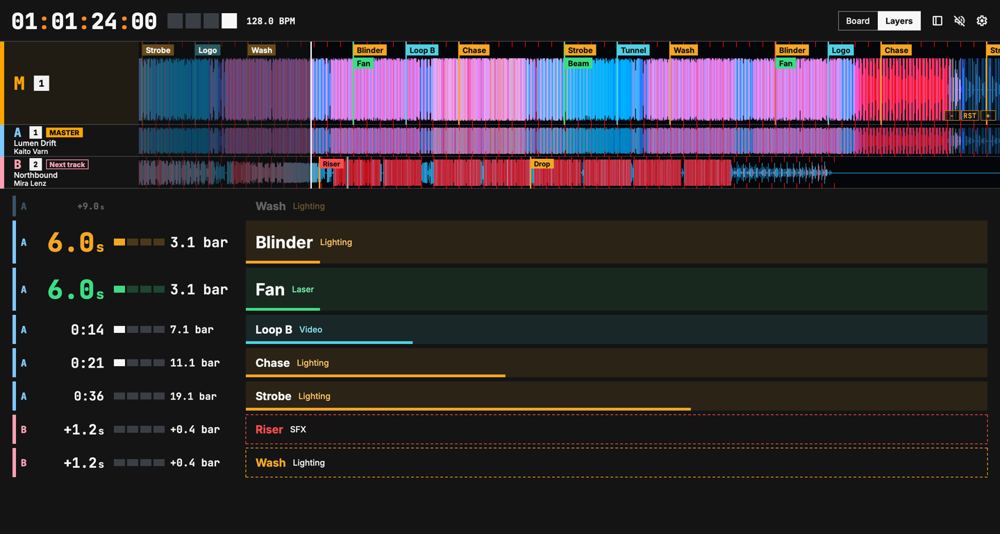 <b>Ebenen</b>, die Spuren MASTER, A und B über der Countdown-Liste.</td>
</tr>
</table>

### Verbleibende Zeit

Sekunden und Beats werden zusammen gezeigt. Unter 10 s haben die Sekunden Zehntel (`4.3 s`); ab 10 s erscheinen sie als Minuten:Sekunden (`0:24`). Takte.Beats zählen wie am CDJ herunter: `2.3 bar` heißt 2 Takte und 3 Beats verbleibend, und der Beat im Takt läuft 4 3 2 1.

In der großen Rückwärtszählung (die letzten 5, 10, 15 oder 30 s, im Einstellungsfenster gewählt) ersetzen die vier Beat-Felder die Takte.Beats. Die letzten Beats zählen 3 2 1 (oder ab 5 oder 10), dann GO; jede Zahl lässt ihre Karte oder Zeile kurz aufleuchten. Ein laufender langer Cue zeigt seinen Namen und die Zeit bis zu seinem Ende.

### Einstellungsfenster (das Zahnrad)

| Bereich | Elemente |
| --- | --- |
| Anzeige | Bildschirm (Board, Ebenen), Großer Countdown ab (5, 10, 15, 30 s), Takt.Schlag und Schlagfelder zeigen, Taktzählung ab (3, 5, 10), Sichtbare Gruppen, Wellenform-Farbe der Spuren (Track (CDJ), Grau, Aus), Folgendes Deck (SMPTE-Master, Tempo-Master, ON-AIR-Deck (automatisch)) |
| Web-Ansicht | die Adresse für Telefone und Tablets, **Adresse kopieren**, **Im Browser öffnen**. Der Web-Viewer muss in den Einstellungen eingeschaltet sein. |
| Sprachansage | Sprechen (Name+Zählen, Nur Name, Nur Zählen), Vorwarnung (8 Beats, 4 Beats), Zählen (3 Beats, Aus), Letztes Wort (GO, Aus), Stimme, Ausgang (Gerät, Kanal, Pegel, Test), Klick (Aus, Beim Zählen, Immer) und Klick-Lautstärke, ein Lautsprecher je Gruppe |

Die Anzeigeeinstellungen gehören zum Fenster; Folgendes Deck und die Sprachansage gelten für alle Fenster. Die Pegel reichen bis 200 %.

### Gesprochene Ansagen

Der Lautsprecher in der Kopfzeile des Cue Calls schaltet die gesprochenen Ansagen ein und aus. Die Sätze werden vorab mit den Systemstimmen (macOS, Windows) erzeugt und während der Show im Beat abgespielt. Die Ansagen folgen dem unter **Folgendes Deck** gewählten Deck.

- 8 (oder 4) Beats vor dem Cue: "Gruppe, Cue-Name, Achtung"; auf den letzten drei Beats "drei, zwei, eins"; beim Cue "los". **Sprechen**, **Zählen** und **Letztes Wort** lassen Teile weg.
- Die Liste **Stimme** zeigt nur Stimmen der Sprachen, die die App sprechen kann (Koreanisch, Englisch, Japanisch, Spanisch, Deutsch, Französisch, Chinesisch), nach Sprache gruppiert. Der erste Eintrag, "Systemstimme …", ist die Standardstimme der Oberflächensprache. Die Wahl einer Stimme in einer anderen Sprache stellt die Ansagen auf diese Sprache um (eine englische Stimme sagt "Lighting, standby", "three, two, one, go"). In der Set List eingegebene Gruppennamen werden unverändert vorgelesen.
- Gibt es keine Stimme für die Sprache, kommen die Ansagen auf Englisch, und der erste Eintrag weist darauf hin. Stimmen werden in den Spracheinstellungen des Betriebssystems hinzugefügt.
- **Ausgang** ist ein Gerät und Kanal für alle Ansagen. Es kann ein anderer Kanal des Geräts sein, das LTC nutzt, aber nicht der LTC-Kanal; diese Kanäle sind mit "von LTC belegt" markiert und nicht wählbar.
- **Klick** klingt während der Zählung oder immer auf jedem Beat; der erste von je 4 klingt höher.
- Der Lautsprecher neben einem Gruppennamen schaltet diese Gruppe stumm. Eine Gruppe wird gesprochen, solange ein offener Cue Call sie zeigt; ist kein Cue Call offen, werden alle gesprochen.

### Webseite

Ist der Web-Viewer in den Einstellungen eingeschaltet, öffnen Telefone, Tablets und andere Rechner im selben Netz `http://<dieser Rechner>:<Port>/cuecall`. Sie fragt zuerst nach dem Zugangscode (derselbe wie beim Web-Viewer) und merkt ihn 12 Stunden; **Im Browser öffnen** auf diesem Rechner überspringt den Code. Das Zahnrad auf der Seite wählt das Thema Board oder Ebenen, die Gruppen, die große Rückwärtszählung, die Beatzählung und Takte.Beats; diese Wahl bleibt in diesem Browser gespeichert. Wo der Browser es erlaubt, verhindert **Bildschirm anlassen**, dass der Bildschirm in den Ruhezustand geht. Für Telefone im Hochformat gibt es ein eigenes Layout. Antwortet ORVIK 3 s lang nicht, wird die Seite abgedunkelt und zeigt Offline, und die Rückwärtszählungen halten an, bis es wieder antwortet.

---

## 12. NETWORK

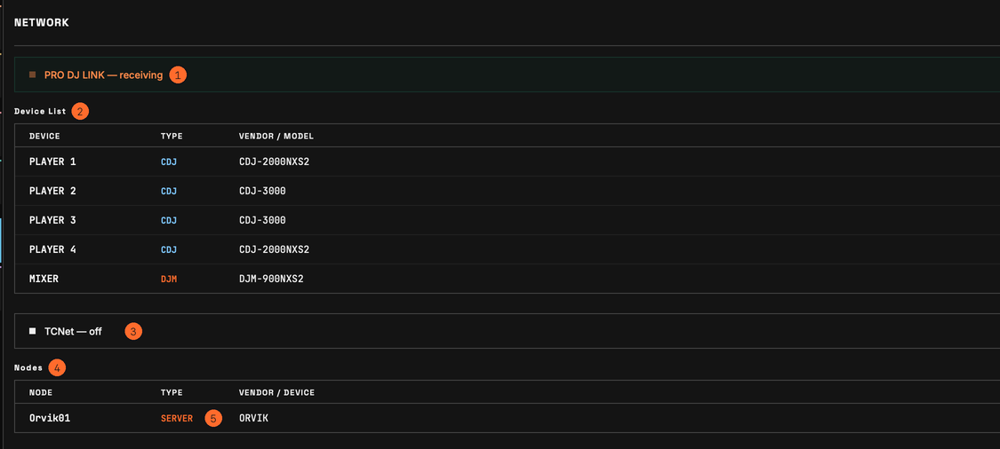

1. **PRO DJ LINK-Zustand** — ob ORVIK bereit ist, PRO DJ LINK zu empfangen. Ob CDJ zu sehen sind, zeigt die Geräteliste.
2. **Geräteliste** — Nummer, Typ, Modell und IP jedes gesehenen CDJ und DJM.
3. **TCNet-Zustand** — ob der TCNET-Schalter eingeschaltet ist, und der Knotenname von ORVIK.
4. **Knotenliste** — ORVIK und die in den letzten 10 s gesehenen TCNet-Knoten.
5. **TYPE** — die Rolle des Knotens: SERVER sendet, CLIENT empfängt; außerdem REPEATER und AUTO. Ist TCNet eingeschaltet und kein CLIENT vorhanden, erscheint ein Hinweis unter der Liste.

### 12.1 Warnungen zur Einrichtung

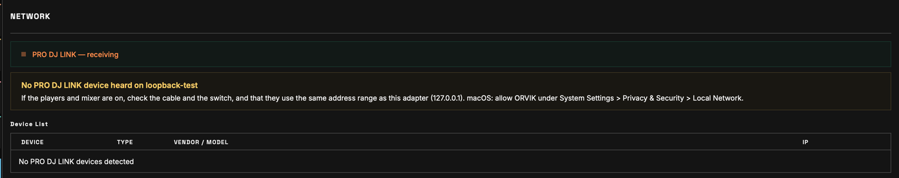

Solange PRO DJ LINK eingeschaltet ist, prüft ORVIK, wie dieser Rechner verbunden ist. Hindert etwas in der Einrichtung Player und Mixer daran, ORVIK zu erreichen, erscheint oben in NETWORK eine Warnung mit Ursache und Abhilfe; die Statusleiste zeigt sie als LINK, und der Tooltip des Schalters PRO DJ LINK nennt sie. Rot heißt, dass auf der Verbindung nichts funktionieren kann; Gelb ist ein Hinweis. Die Warnungen beginnen 10 s nach dem Start von PRO DJ LINK und sind nur Hinweise: ORVIK ändert keine Netzwerkeinstellung.

| Warnung | Wann | Was tun |
| --- | --- | --- |
| Ein anderes Programm belegt PRO DJ LINK-Ports | ein anderes Programm belegt die PRO DJ LINK-Ports (50000–50002); es wird genannt, wenn ORVIK es erkennen kann | Beenden Sie es und schalten Sie PRO DJ LINK aus und wieder ein. Häufige Ursachen: rekordbox, ein weiteres ORVIK, AnyDesk, Microsoft Teams während eines Anrufs, PRO DJ LINK-Tools wie Beat Link Trigger. |
| Geräte in einem anderen Netz | Player oder Mixer senden über dieses Kabel, ihre Adressen liegen aber außerhalb des Netzes dieses Adapters (etwa Geräte mit selbst zugewiesenen 169.254.x.x-Adressen und ein Adapter mit einer Router-Adresse) | Stellen Sie den Adapter auf automatischen Adressbezug (DHCP) oder geben Sie ihm eine Adresse aus dem Bereich der Geräte, oder verbinden Sie alles mit demselben Router. |
| Kein PRO DJ LINK-Gerät zu hören | am gewählten Adapter ist nichts angekommen (unter Windows mit automatischer Erkennung an keinem Adapter), oder die Verbindung ist seit 15 s still | Prüfen Sie, ob Player und Mixer eingeschaltet sind, Kabel und Switch sowie den Adressbereich. macOS: Erlauben Sie ORVIK unter Systemeinstellungen > Datenschutz & Sicherheit > Lokales Netzwerk. Windows: Ein Adapter ohne Router gilt als öffentliches Netz; erlauben Sie ORVIK auch in öffentlichen Netzen. Weitere aktive Adapter werden aufgeführt, damit Sie in den Einstellungen den richtigen wählen können. |
| Zwei Adapter im selben Netz | zwei Adapter dieses Rechners sind im selben Netz, daher können Titeldaten und Wellenform-Anfragen über den falschen hinausgehen | Schalten Sie den anderen Adapter aus, trennen Sie ihn oder legen Sie ihn in ein anderes Netz. |

---

## 13. OUTPUT

Sendet Deck- und Mixerwerte als OSC, DMX (Art-Net, sACN) und MIDI an andere Programme und Geräte. Es ist ein Node-Editor, der die frühere OSC-Seite und den DMX-Patch von ART-NET vereint. OSC-Zeilen und DMX-Patches aus 1.6 werden beim ersten Start in Nodes umgewandelt und senden dieselben Werte.

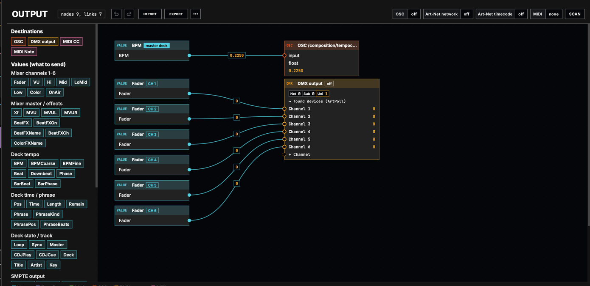

### Oberer Bereich

- **Rückgängig, Wiederholen** — macht Änderungen auf der Seite rückgängig und wiederholt sie: Strg+Z (Cmd+Z am Mac) sowie Strg+Umschalt+Z oder Strg+Y (Cmd+Umschalt+Z am Mac).
- **IMPORT, EXPORT** — EXPORT speichert die ganze Seite (Nodes, DMX-Ausgänge, OSC-Zeilen, Netzwerkeinstellungen) in eine Datei; IMPORT lädt eine, und ein einziges Rückgängig nimmt das zurück. Würde eine Datei das Senden einschalten, listet ORVIK die Ziele auf und fragt zuerst.
- **⋯** — **Autospeicher-Verlauf…** holt eine frühere Kopie der Nodes zurück. [Autospeicher](#autospeicher-verlauf)
- **OSC** — zeigt das OSC-Ziel (Adresse:Port) oder aus. Ein Klick stellt die OSC-Ausgabe ein: ein oder aus, **Dieser Computer**, **Broadcast** oder **IP-Adresse**, die IP und den Port (Standard 7000). **Weitere OSC-Ziele (Cue-Aktionen)** enthält benannte Adressen für die OSC-Aktionen des Cue-Editors; + fügt eine hinzu, × entfernt sie.
- **Art-Net-Netzwerk** — zeigt Schnittstelle und DMX-Rate oder aus. Ein Klick zeigt, was alle DMX-Ausgänge gemeinsam nutzen: **Art-Net ein (Timecode und DMX)**, die DMX-Schnittstelle (sie kann der Timecode-Schnittstelle folgen), den DMX-Port (6454), die DMX-Rate (10–60 Hz, Standard 40), die verwendete Broadcast-Adresse, ArtSync und ArtPollReply. Der OSC-Ausgabeport kann nicht für Art-Net genutzt werden.
- **Art-Net-Timecode** — zeigt die Framerate oder aus. Ein Klick zeigt **Timecode senden**, den sendenden Layer mit dem gerade ausgehenden Timecode, die Timecode-Schnittstelle, das Ziel (Broadcast oder eine IP-Adresse) und den Timecode-Port. Er braucht eingeschaltetes Art-Net unter **Art-Net-Netzwerk**. Die Framerate ist **Bildrate** unter SMPTE-Timecode-Ausgang in den [Einstellungen](#15-einstellungen); jeder Layer wird mit der Schaltfläche ART in SMPTE OUT eingeschaltet.
- **MIDI** — der MIDI-Ausgang für die Nodes MIDI CC und MIDI Note. Ein Klick wählt ein Gerät. Es ist derselbe Port wie **MIDI-Ausgang** unter MIDI-Clock-Ausgabe in den Einstellungen.
- **SCAN** — sucht Art-Net-Geräte (ArtPoll), OSC-Programme (mDNS) und MIDI-Ausgänge und listet sie auf. + neben einem Art-Net-Gerät fügt seine IP den Empfängern des ersten DMX-Ausgangs hinzu; + neben einem OSC-Programm fügt es den weiteren OSC-Zielen hinzu.

### Linke Liste

Klick auf ein Element erzeugt seinen Node auf der Fläche. Mauszeiger über der Liste zeigt eine kurze Anleitung.

| Gruppe | Nodes |
| --- | --- |
| Ziele | OSC, DMX-Ausgang, MIDI CC, MIDI Note |
| Werte: Mixer Kanal 1-6 | Fader, VU, Hi, Mid, LoMid, Low, Color, OnAir |
| Werte: Mixer Master / Effekte | Xf, MVU, MVUL, MVUR, BeatFX, BeatFXOn, BeatFXName, BeatFXCh, ColorFXName |
| Werte: Deck Tempo | BPM, BPMCoarse, BPMFine, Beat, Downbeat, Phase, BarBeat, BarPhase |
| Werte: Deck Zeit / Phrase | Pos, Time, Length, Remain, Phrase, PhraseKind, PhrasePos, PhraseBeats |
| Werte: Deck Status / Track | Loop, Sync, Master, CDJPlay, CDJCue, Deck, Title, Artist, Key |
| Werte: SMPTE-Ausgabe | SMPTEA, SMPTEB, SMPTEM, Clock |
| Umformungen | Bereich, Form (sin, tri, saw, sq), Invertieren, Freilauf, Zeitformat |
| Mathe | Addieren, Subtrahieren, Multiplizieren, Dividieren, Minimum, Maximum |
| Spezial | Begrenzen, Schwelle, Glätten, Zeilenumbruch |
| Eingabe | Ganzzahl, Kommazahl, Text |

### Fläche und Einstellungen rechts

Ziehen Sie vom Ausgangspunkt eines Nodes zum Eingangspunkt eines anderen, um sie zu verbinden; ein auf einem Node abgelegtes Kabel geht an seinen nächsten Eingang. Der fließende Wert ist auf dem Kabel zu sehen. Ein Wert kann an mehrere Ziele gehen. Ein Umformungs- oder Rechen-Node ohne Kabel wird beim Ablegen auf einem Kabel darin eingefügt. Textwerte (Titel, Künstler, Tonart) können nur an OSC gehen; ein Kabel von einem Textwert zu DMX oder MIDI wird abgewiesen und der Grund angezeigt.

- **Auswählen** — Klick auf einen Node; Ziehen auf der leeren Fläche wählt mehrere; Umschalt+Klick oder Strg+Klick (Cmd+Klick am Mac) fügt einen hinzu oder entfernt ihn. Entf löscht die gewählten Nodes.
- **Kontextmenü** — Ausschneiden, Kopieren, Einfügen, Duplizieren, Löschen, Verbindungen lösen, Alles auswählen, Gruppieren, Gruppierung aufheben. Strg+G (Cmd+G am Mac) gruppiert die gewählten Nodes, mit Umschalt hebt es die Gruppierung auf. Eine Gruppe wird an ihrem Namensband gezogen; Doppelklick auf das Band benennt sie um.
- **Verschieben** — Nodes rasten an Kanten und Mitten anderer Nodes ein; mit gedrückter Alt-Taste lassen sie sich frei platzieren. Leertaste halten und ziehen verschiebt die Ansicht. Auf einem Touchscreen verschiebt Ziehen der leeren Fläche mit dem Finger die Ansicht; den Finger kurz ruhig halten und dann ziehen wählt Nodes.
- **Probleme** — ein Node, der nicht senden kann, nennt den Grund: nicht verbunden, so nicht sendbar, Kanal doppelt, über dem Limit, Schleife, Universe von anderem DMX-Ausgang belegt.

Beim Auswählen eines Nodes erscheinen seine Einstellungen rechts.

- **Wert-Nodes** — Wert und Deck: Master-Deck oder Deck 1–6. Beat und Phase können 1-, 2-, 4-, 8- oder 16-mal je Beat laufen; Downbeat, BarBeat und BarPhase mehrmals je Takt (mit Form).
- **OSC** — Adresse und Typ. Textwerte gehen als String; Zahlen als float oder int; Zahlen, die auch eine Textform haben (Time, Length, BPM usw.), als float, int oder string. Gesendet wird nur bei Änderung, höchstens 60-mal je Sekunde. Ein fehlender `/` am Anfang wird ergänzt; Leerzeichen und `# * , ? [ ] { }` sind nicht erlaubt.
- **DMX-Ausgang** — **Dieses Universe senden** schaltet den Ausgang ein. **Art-Net-Adresse** besteht aus Net (0–127), Subnet (0–15) und Universe (0–15); jeder DMX-Ausgang braucht ein eigenes Universe. **Empfänger-IPs** nimmt Adressen, getrennt durch Kommas oder Leerzeichen; bleibt das Feld leer, sendet der erste DMX-Ausgang an die per ArtPoll gefundenen Geräte und die anderen an die Broadcast-Adresse des Art-Net-Netzwerks. Der erste DMX-Ausgang kann auch als sACN senden (**Auch als sACN senden**); Universe, Priorität und weitere sACN-Einstellungen stehen unter **sACN-Ausgabe** in den [Einstellungen](#15-einstellungen). Verbinden Sie einen Wert mit **+ Kanal**, um ihm den nächsten Kanal zu geben; Klick auf eine Kanalnummer im Node ändert sie. Werte 0–1 werden als 0–255 gesendet.
- **MIDI CC, MIDI Note** — MIDI-Kanal (1–16) und CC- oder Notennummer (0–127). Werte 0–1 werden als 0–127 gesendet.
- **Bereich** — wandelt einen Wert 0–1 in Von–Bis. Ein Von größer als Bis kehrt die Richtung um. BPM behandelt 20–500 BPM als 0–1.
- **Form** — wandelt einen Wert 0–1 in eine sin-, tri-, saw- oder sq-Welle, mit einem Schalter Invertieren; **Invertieren** ist 1 − Wert.
- **Freilauf** — lässt einen Beat-Wert (Beat, Downbeat, Phase, BarBeat, BarPhase) im Tempo des Decks eigenständig weiterlaufen, zwischen den Beat-Meldungen des CDJ und ohne sie.
- **Zeitformat** — wählt die Felder (hh, mm, ss, ff) eines Zeitwerts (Time, Length, Remain, SMPTE, Clock). Siehe "Zeitformat" unten.
- **Addieren, Subtrahieren, Multiplizieren, Dividieren, Minimum, Maximum** — nehmen so viele Eingänge, wie Sie verbinden; bei einem Eingang gilt der **Zweite Wert**. Fader und Pegel zählen als 0 bis 1, BPM und Zählwerte als Zahlen. **Addieren** verbindet auch Texte: "A" + "B" = "AB".
- **Begrenzen** — hält einen Wert zwischen **Unten** und **Oben**. **Schwelle** sendet ab ihrem Wert 1, sonst 0.
- **Glätten** — verlangsamt einen Wert. **Attack (ms)** gibt an, wie schnell er einem Anstieg folgt, **Halten (ms)**, wie lange er die Spitze hält, wenn der Eingang fällt, **Release (ms)**, wie schnell er danach fällt. Größer ist langsamer; 0 folgt sofort. Ein Glätten-Node, der vor diesen drei Einstellungen gespeichert wurde, behält seine eine Zeit für beide Richtungen.
- **Zeilenumbruch** — verbindet Textwerte über mehrere Zeilen (etwa Titel / Künstler).
- **Ganzzahl, Kommazahl, Text** — ein eingegebener Wert. Ein Text kann nur an OSC gehen.

Die Werte werden in der Ausgabe-Engine berechnet, sie werden also weiter gesendet, während eine andere Seite angezeigt wird.

### Wertnamen und was sie senden

Werte, die ohne Bereich gesendet werden.

| Gruppe | Name | Wert |
| --- | --- | --- |
| Je Mixerkanal (1–6) | Fader, VU, Hi, Mid, LoMid, Low, Color | 0–1 |
| | OnAir | 1 wenn on air, sonst 0 |
| Mixer gesamt | Xf, MVU, MVUL, MVUR, BeatFX | 0–1 |
| | BeatFXOn | 1 bei Beat FX ON |
| | BeatFXName, BeatFXCh, ColorFXName | gewählter Beat FX, Kanal, auf den er wirkt, Name des Colour FX (String) |
| Je Deck und Master-Deck | BPM | das BPM unverändert (als String, eine Nachkommastelle: `128.0`). BPMCoarse ist der ganzzahlige Teil, BPMFine der Bruchteil |
| | Pos | Fortschritt 0–1 (als String `42%`) |
| | Beat, Downbeat | eine kurze 1 auf jedem Beat, eine kurze 1 auf dem ersten Beat des Takts |
| | Phase | Position im Beat 0–1 |
| | BarBeat | welcher Beat im Takt, 1–4 |
| | BarPhase | Position im Takt 0–1 (ein Durchlauf je vier Beats) |
| | Phrase | rekordbox-Phrasenname (String, z. B. `CHORUS`) |
| | PhraseKind | Phrasennummer: Intro 1, Verse 2, Bridge 3, Chorus 4, Up 5, Down 6, Outro 7 (0 ohne Phrase) |
| | PhrasePos, PhraseBeats | Position in der Phrase 0–1, Beats bis zur nächsten |
| | Loop, Sync | 1 im Loop, 1 bei aktivem Sync |
| | Title, Artist, Key | Titel, Künstler und Tonart (String) |
| | Time, Length, Remain | vergangene, gesamte und verbleibende Zeit (String, `MM:SS`, verbleibend als `-MM:SS`) |
| Nur je Deck | CDJPlay, CDJCue | 1 bei Wiedergabe, 1 solange CUE gehalten wird |
| | Master | 1 wenn dieses Deck der CDJ-Master ist |
| Nur Master-Deck | Deck | Player-Nummer des Masters 1–6 |
| SMPTE, Uhr | SMPTEA, SMPTEB, SMPTEM | Timecode der Layer A, B, MASTER von SMPTE OUT wie im Dock zu sehen (String, `HH:MM:SS:FF`, Drop Frame 29,97 `HH:MM:SS;FF`, mit Offset) |
| | Clock | Rechnerzeit (String, `HH:MM:SS`) |

- Das Master-Deck ist das des MASTER BPM in der Kopfzeile. Ohne CDJ-Master wird ein laufendes Deck genommen, zuerst eines, das on air ist.
- Das an die Tempo-Adresse von Resolume (`/composition/tempocontroller/tempo`) gesendete BPM geht als 0–1 (20–500 BPM), weil Resolume dort 0–1 erwartet.
- Ohne Mixer werden keine Mixerwerte gesendet, weil eine 0 einen an einen Fader gebundenen Layer abschalten würde. Ebenso wird das BPM eines Decks ohne BPM nicht gesendet.
- Ein/Aus-Werte (OnAir, BeatFXOn, Loop, Sync, CDJPlay, CDJCue, Master) und Deck können auch als String gesendet werden (`ON`, `OFF`, `2`).

### Zeitformat

Ein Zeitformat-Node auf einem Zeitwert sendet nur die gewählten Felder.

| Buchstaben | Feld |
| --- | --- |
| `hh`, `h` | Stunden |
| `mm`, `m` | Minuten |
| `ss`, `s` | Sekunden |
| `ff`, `f` | Frames (nur SMPTE) |

Zwei Buchstaben senden das Feld zweistellig mit führender Null; ein Buchstabe unverändert. Mehrere Felder werden mit `:` verbunden (z. B. `mmss` → `05:08`, `hmmss` → `0:05:08`). Titelzeiten ohne `h` zählen die Minuten über 60 hinaus weiter. Formatiertes Remain wird ohne `-` gesendet. 29,97-Drop-Frame-Code hat `;` vor den Frames.

---

## 14. SHORTCUT und MAP

Tastatur, MIDI, OSC und DMX (Art-Net) drücken die Schaltflächen von ORVIK und ändern seine Werte: die Bedienelemente von SMPTE OUT für die Layer A, B und MASTER sowie PRO DJ LINK, TCNET und M.VOL in der Kopfzeile. Eingestellt wird nur der Empfang; der Ein/Aus-Zustand eines zugewiesenen Bedienelements kann an ein MIDI-Gerät zurückgemeldet werden.

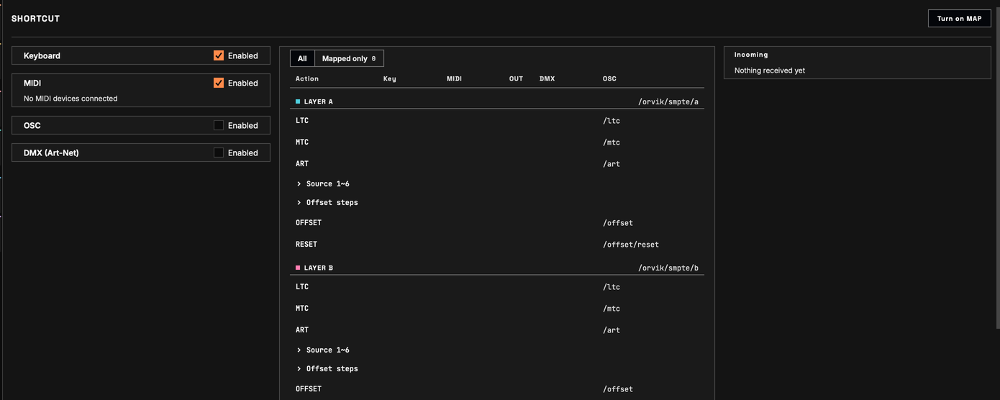

### Seite SHORTCUT

Links liegen die Eingänge. Jeder hat einen eigenen Schalter **Aktiviert**.

| Bereich | Inhalt |
| --- | --- |
| Tastatur | Tastenkombinationen, nur wenn das ORVIK-Fenster im Vordergrund ist. Standardmäßig ein. |
| MIDI | jedes verbundene MIDI-Gerät mit **IN** (abhören) und **OUT** (den Zustand der zugewiesenen Bedienelemente an das Gerät zurückmelden, für Controller-LEDs). Standardmäßig ein. |
| OSC | OSC-Empfangsport (Standard 7700), wo abgehört wird (alle Schnittstellen, nur dieser Rechner oder eine Schnittstelle) und die IPs, die senden dürfen. Eine leere Liste lässt jeden im Netz ORVIK steuern: tragen Sie am Veranstaltungsort die IPs ein. Standardmäßig aus. |
| DMX (Art-Net) | Steuerung aus den Kanälen eines Art-Net-Universums (Net / Subnet / Universe), das ein Lichtpult sendet. Nutzt dieselben zugelassenen IPs wie OSC. Zum Teilen mit Resolume auf diesem Rechner senden Sie vom Pult als Broadcast. Standardmäßig aus. |

**MAP einschalten** oben rechts auf der Seite wechselt zu DECKS und schaltet MAP ein.

Die Tabelle listet jede Aktion, gruppiert als LAYER A, LAYER B, MASTER und Kopfzeile; die Zeilen Quelle und Offset-Schritte klappen zu ihren Aktionen auf und zeigen, wie viele zugewiesen sind. **Alle** zeigt jede Aktion, **Nur zugewiesene** die zugewiesenen.

- **Taste, MIDI, DMX** — eine Zelle anklicken, dann eine Taste drücken oder MIDI oder DMX senden, um sie zuzuweisen. Die Zelle zeigt währenddessen WARTE.
- **MIDI-Modus** — die Marke an einer zugewiesenen MIDI-Zelle; Klick wechselt ihn. Ein/Aus-Elemente: **Toggle** schaltet bei jedem Druck um, **Piano** ist nur an, solange gedrückt wird (auch für rastende Tasten, die 127/0 senden). Werte: **Absolute** nimmt die Fader- oder Reglerstellung, **Relative** ist für Endlos-Encoder, 1 % je Schritt.
- **OUT** — die für aus und ein zurückgesendeten MIDI-Werte (Standard 0 und 127). Ein APC mini mk2 erhält zusätzlich eine Farbpalette und eine Wahl für Helligkeit oder Blinken.
- **OSC** — die feste OSC-Adresse der Aktion, z. B. `/orvik/smpte/a/ltc`. Klick kopiert sie.
- **×** — entfernt die Zuweisungen der Zeile.

In einem breiten Fenster zeigt ein Panel rechts **Eingänge**, die zuletzt empfangenen Eingaben und was sie bewirkt haben, und bei eingeschaltetem OSC die **OSC-Regeln**: Ein/Aus nimmt 1 für ein, 0 für aus, ohne Wert wird umgeschaltet; Tasten lösen ohne Wert oder mit einem Wert ungleich 0 aus (0 wird ignoriert); Werte nehmen Float 0–1 (0–100 geht auch); Quellen nehmen auch einen Wert (`/orvik/smpte/a/src 3`).

### MAP

MAP in der Seitenleiste (oder **MAP einschalten** auf der Seite SHORTCUT) wechselt in den Zuweisungsmodus; erneut MAP oder Esc verlässt ihn. Zuweisbare Bedienelemente sind umrandet: gestrichelt, wenn frei, durchgezogen mit Chips (K Taste, M MIDI, D DMX), wenn zugewiesen. Klicken Sie eines an: Die Leiste oben zeigt seinen Namen und seine OSC-Adresse (Klick kopiert sie). Drücken Sie dann eine Taste oder senden Sie MIDI oder DMX, um es zuzuweisen. **Löschen** entfernt seine Zuweisungen, **Abbrechen** beendet das Warten. OSC-Adressen sind fest und brauchen keine Zuweisung.

### Tasten, die immer funktionieren

| Taste | Aktion |
| --- | --- |
| Strg+R (Cmd+R am Mac) | lädt den Bildschirm neu. Die Wiedergabe der virtuellen Decks stoppt. |
| Strg+Z (Cmd+Z am Mac) | Rückgängig in SET LIST und OUTPUT, außerhalb von Textfeldern |
| Strg+Umschalt+Z oder Strg+Y (Cmd+Umschalt+Z am Mac) | Wiederholen |
| Esc | verlässt MAP |
| ⌘M (macOS) | Fenster > Im Dock ablegen |
| ⌘W (macOS) | Fenster > Schließen: schließt ein Cue-Call-Fenster; im Hauptfenster beendet es ORVIK wie die Schließen-Schaltfläche |

---

## 15. Einstellungen

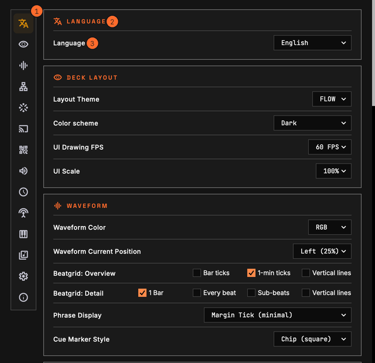

SETTINGS in der Seitenleiste öffnet das Einstellungsfenster; ein erneuter Klick schließt das Fenster.

1. **Bereichssymbole** — Klick springt zu diesem Bereich.
2. **Bereiche** — die Einstellungen sind wie folgt gruppiert.
3. **Einstellungen** — Name links, Wert rechts. Mauszeiger über einer Zeile zeigt ihre Beschreibung.

Bei jedem Öffnen des Fensters werden die Listen der Audio-, LTC- und MIDI-Geräte neu eingelesen. Die Schnittstellenlisten werden bei jedem Aufklappen neu eingelesen.

### Sprache

| Punkt | Beschreibung |
| --- | --- |
| Sprache | Sprache der Oberfläche. Systemsprache folgt dem Rechner. English, 한국어, 日本語, Español, Deutsch, Français, 繁體中文. |

### Deck-Layout

| Punkt | Beschreibung |
| --- | --- |
| Layout-Thema | Layout der Deck-Seite: FLOW, STK, STRIP oder ROW. [6.3](#63-layouts) |
| Farbschema | Dunkel, oder Hell (draußen) für helle Umgebungen. |
| UI-Zeichen-FPS | wie oft je Sekunde der Bildschirm neu gezeichnet wird: 60, 30 oder 15. Weniger spart CPU. Die Senderaten sind unabhängig davon. |
| UI-Skalierung | Größe des gesamten Bildschirms: 100%, 125% oder 150%. |

### Wellenform

| Punkt | Beschreibung |
| --- | --- |
| Wellenformfarbe | 3-BAND, RGB oder MONO. Titel ohne 3band-Daten werden in RGB gezeigt. |
| Playhead-Position | wo die Positionslinie in der Detail-Wellenform liegt: Mitte (Center) oder Links (Left 25%). |
| Beatgrid: Übersicht | die Markierungen auf der Gesamt-Wellenform: Taktmarken, 1-Min-Marken, Vertikale Linien. |
| Beatgrid: Detail | das Raster auf der Detail-Wellenform: 1 Takt, Jeder Beat, Sub-Beats, Vertikale Linien. Auch die Spuren des Cue Calls nutzen es. |
| Phrase-Anzeige | wie Phrasen (INTRO, CHORUS usw.) auf der Wellenform gezeigt werden: Keine, Randmarke (minimal), Phrase-Namen (INTRO/CHORUS/OUTRO) oder Farbwechsel. |
| Cue-Marker-Stil | Form der Cue-Markierungen: Chip (Rechteck), Flag (Pentagon) oder Stripe (Streifen). |

### PRO DJ LINK

| Punkt | Beschreibung |
| --- | --- |
| PRO DJ LINK-Schnittstelle | Netzwerkschnittstelle, an der CDJ und DJM hängen. Automatische Erkennung wählt die Seite, auf der CDJ zu sehen sind, und zeigt die genutzte Adresse. Jede Schnittstelle steht mit Name und Adresse in der Liste; solche mit 169.254.x.x sind als link-lokaler CDJ markiert. Eine gewählte, aber fehlende Schnittstelle bleibt als "nicht vorhanden — läuft automatisch" stehen, und die Engine nutzt derweil die automatische Erkennung. Ein Wechsel, während Geräte senden, fragt nach, weil das Neubinden die Ausgabe kurz unterbricht; Abbrechen behält die alte. |
| Status | Verbindungszustand dieser Schnittstelle. |
| PRO DJ LINK automatisch starten | verbindet beim Start von ORVIK mit CDJ und DJM. Standardmäßig ein. Die Beschreibung der Zeile nennt die Ports: UDP 50000–50002 und dbserver-TCP. Belegt ein anderes Programm sie, meldet NETWORK das. [12.1](#121-warnungen-zur-einrichtung) |

### TCNet

| Punkt | Beschreibung |
| --- | --- |
| Knotenname | Name dieses Rechners in TCNet. %% ist eine automatische Nummer; höchstens 8 Zeichen. |
| TCNet-Schnittstelle | Netzwerkschnittstelle, über die TCNet gesendet wird. Ein Wechsel, während TCNet-Knoten zu sehen sind, fragt nach. |
| Status | Verbindungszustand dieser Schnittstelle. |
| Bildrate | Framerate des über TCNet gesendeten Timecodes: 24, 25, 29,97 oder 30. |
| TCNet-Modus | Auto wartet, wenn es einen früheren Server gibt, Server sendet immer, Client sendet nie. |
| TCNet automatisch starten | startet die Ausgabe an Arena beim Start von ORVIK. Standardmäßig ein. Die Beschreibung der Zeile nennt die Ports: UDP 60000–60002. |

### Mirror-Modus

| Punkt | Beschreibung |
| --- | --- |
| Mirror-Server bereitstellen | erlaubt ORVIK auf einem anderen Rechner, diesen zu spiegeln (TCP 8878). |
| Anderen PC spiegeln | verbindet automatisch mit einem Mirror-Server, wenn dieser Rechner keine Decks hat. Standardmäßig ein. |
| Mirror-Server | der zu spiegelnde Server. Aktualisieren sucht erneut; der Verbindungszustand steht daneben. Erlauben Sie auf dem Server-Rechner in der Firewall eingehende Verbindungen auf TCP 8878. |

Beim Spiegeln ersetzen MIRROR und die Serveradresse die Schaltflächen PRO DJ LINK und TCNET in der Kopfzeile; CONNECTING erscheint vor dem Verbinden und beim erneuten Verbinden. Ein spiegelnder Rechner sendet kein TCNet. Klick auf MIRROR öffnet die Einstellungen.

### Web-Viewer

| Punkt | Beschreibung |
| --- | --- |
| Web Viewer | erlaubt, die Deck-Seite und die Cue-Call-Seite aus Browsern im selben Netz zu sehen (nur lesen). |
| Port | Port des Web-Viewers (Standard 8877). |
| Schnittstelle | Netzwerkschnittstelle, an der der Web-Viewer lauscht. |
| Status | Aus, oder Läuft und der Port. Eingeschaltet erscheinen darunter ein QR-Code, der Zugangscode und die Adressen. |
| REST-API | schreibgeschützte GET-Anfragen an den Server des Web-Viewers, mit demselben Zugangscode und derselben Sitzung. Die Beschreibung der Zeile nennt die Pfade unter `/api/v1/` (status, decks, layers, timecode, mixer, outputs; JSON). Der Web-Viewer muss eingeschaltet sein. |
| API-Status | die API-Adresse und die Zahl der Anfragen, oder warum sie nicht antwortet. |

### Audio-Ausgang

| Punkt | Beschreibung |
| --- | --- |
| Ausgabegerät | Audiogerät für den Ton der virtuellen Decks: Systemstandard oder ein Gerät. |
| Ausgabekanal | das Ausgabekanalpaar für den Ton der virtuellen Decks (1/2, 3/4 usw.). |

### SMPTE-Timecode-Ausgang

| Punkt | Beschreibung |
| --- | --- |
| Bildrate | Framerate von LTC, MTC und Art-Net-Timecode: 23,98, 24, 25, 29,97 oder 30 fps. |
| Latenzausgleich | ms, die auf den Timecode addiert werden (−5000 bis 5000); positiv läuft vor. Gemeinsam für LTC, MTC und Art-Net, zum Ausgleich der Verzögerung des Empfängers. |
| LTC: Layer A, LTC: Layer B, LTC: MASTER | Audiogerät (Keine oder ein Gerät), Kanal und Pegel für den LTC jedes Layers. Der Pegel reicht von −40 bis 0 dBFS, Standard −12; Doppelklick auf den Regler setzt ihn zurück. Anheben, wenn der Empfänger nicht einrastet, senken, wenn er verzerrt. |
| LTC im Stopp halten | stoppt ein Deck, sendet LTC weiter dessen gestopptes Frame: Der Empfänger stoppt sofort, und ein Deck bei 0 zeigt 00:00:00:00. Aus: kein LTC im Stopp. Standardmäßig ein. |
| MASTER folgt dem Master-Deck | steht MASTER auf A oder B und wechselt der CDJ-Master auf das Deck des anderen Layers, wechselt MASTER auf diesen Layer. Standardmäßig ein. |
| ON-AIR-Deck halten, bei Stille übergeben | mit einem DJM hält MASTER das ON-AIR-Deck (spielt mit offenem Fader oder ON AIR). Stoppt es (0,5 s) oder wird sein Fader heruntergezogen (2 s), wechselt MASTER auf das CDJ-Master-Deck, wenn es on air ist, sonst auf das ON-AIR-Deck des anderen Layers. Ohne Mixer folgt MASTER der Taste MASTER; ein gestopptes MASTER-Deck übergibt nach 0,5 s an das laufende Deck des anderen Layers. Aus: nur die Taste MASTER. Standardmäßig ein. |
| ON-AIR-Deck wählen (mit Restzeit) | MASTER wählt das Deck, das gerade zu hören ist, nach Fader, Wiedergabe und Restzeit (so wie das Layout FLOW sein Hauptdeck wählt) und hält es 5 s. Es kann wechseln, bevor der DJ MASTER drückt. Braucht einen DJM im Netz; ohne DJM folgt MASTER der Taste MASTER. Standardmäßig aus. |
| MTC MIDI-Ausgang | MIDI-Port für MTC. |

### sACN-Ausgabe

| Punkt | Beschreibung |
| --- | --- |
| sACN-Ausgabe | sendet sACN (E1.31) mit den Kanälen des ersten DMX-Ausgangs der Seite OUTPUT. Es ist derselbe Schalter wie **Auch als sACN senden** in diesem Node. |
| Übertragung | Multicast oder Unicast. |
| Unicast-IP | die Adresse des Empfängers bei Unicast. |
| Schnittstelle | Netzwerkschnittstelle, über die sACN gesendet wird. |
| Universe | das sACN-Universe, 1–63999. |
| Priorität | 0–200, Standard 100. |
| Quellname | der Name, den Empfänger anzeigen, Standard ORVIK. |
| Status | aus, wartend, oder Ziel, Universe, Priorität und gesendete Pakete. |

### MIDI-Clock-Ausgabe

| Punkt | Beschreibung |
| --- | --- |
| MIDI-Clock-Ausgabe | sendet MIDI Clock (24 PPQN) mit Start, Stop, Continue und Song Position Pointer. |
| Quelle | das Tempo, dem sie folgt: Master-Deck, Layer A, Layer B, MASTER-Layer oder DECK 1–6. |
| MIDI-Ausgang | MIDI-Port für MIDI Clock, getrennt vom MTC MIDI-Ausgang gewählt. Die Nodes MIDI CC und MIDI Note der Seite OUTPUT nutzen denselben Port. |
| Clock auch im Stopp | lässt die Tempo-Clock weiterlaufen, während das Deck steht. Standardmäßig ein. |
| Status | Deck, BPM, läuft oder gestoppt und die gesendeten Clocks, oder was fehlt. |

### Track-Bibliothek

| Punkt | Beschreibung |
| --- | --- |
| Track-Bibliothek | speichert für die Cue-Bearbeitung Wellenform, Beatgrid, Phrasen und Cue-Punkte der gespielten CDJ-Titel sowie die Pfade von Audiodateien. Standardmäßig ein; ausgeschaltet wird nichts geschrieben, und der Cue-Editor hat keine CDJ-Wellenformen. |

### Einstellungsdatei

| Punkt | Beschreibung |
| --- | --- |
| Sicherung | **Einstellungen speichern** schreibt die Einstellungen in eine verschlüsselte Datei (.orvikcfg). **Einstellungen laden** lädt eine nach Rückfrage und startet ORVIK neu. Die Datei enthält weder Fensterpositionen noch History oder Set List, und History und Set List dieser Sitzung bleiben erhalten. Einstellungsdateien aus 1.6 werden ebenfalls geladen; ihre OSC-Zeilen und ihr DMX-Patch werden zu OUTPUT-Nodes. |
| Auslieferungszustand | **Werkseinstellungen** setzt nach Rückfrage alle Einstellungen auf den Ausgangswert und startet ORVIK neu. History und Set List dieser Sitzung bleiben erhalten. |

### Info

| Punkt | Beschreibung |
| --- | --- |
| Version | aktuelle Version von ORVIK, gekennzeichnet als Kostenlose Beta. |
| Nach Updates suchen | eingeschaltet sucht es beim Start und alle 12 Stunden auf GitHub nach einer neuen Version. **Jetzt prüfen** prüft sofort; bei neuer Version erscheinen darunter ihre Nummer und die Schaltfläche **Download-Seite**. |
| Copyright | Copyright-Hinweise zu ORVIK und JUCE sowie die Schaltfläche REPORT für Anfragen. |
| Open Source | **Lizenzdateien** öffnet den Ordner der Lizenzdateien in der App (unter Windows wird er in einen temporären Ordner entpackt); **Lizenzen und Quellcode** öffnet die Open-Source-Hinweise auf der GitHub-Seite von ORVIK. |

---

## 16. Marken und Lizenzen

ORVIK ist ein unabhängiges Kompatibilitätswerkzeug. Es ist weder die offizielle PRO DJ LINK Bridge von AlphaTheta noch das ShowKontrol von TC Supply und bedeutet keine Verbindung, Förderung, Zertifizierung oder Billigung durch AlphaTheta, Pioneer DJ, TC Supply oder Resolume.

AlphaTheta, Pioneer DJ, CDJ, DJM, PRO DJ LINK, rekordbox, TC Supply, TCNet, ShowKontrol, Resolume, SMPTE und weitere Produkt-, Technologie- und Markennamen dienen der Beschreibung der Kompatibilität. Die Rechte an jeder Marke liegen bei ihrem Inhaber. Art-Net™ Designed by and Copyright Artistic Licence.

ORVIK nutzt das Framework JUCE 9, die damit gelieferten Open-Source-Komponenten und die Schriften. Liste und Lizenztexte stehen im Bereich **Info** des Einstellungsfensters (**Lizenzdateien**, **Lizenzen und Quellcode**) und in THIRD_PARTY_NOTICES. Die Nutzungsbedingungen der App stehen in BINARY_LICENSE.

