# Manual de usuario de ORVIK (2.0)

Este manual describe las pantallas de ORVIK y sus partes. Los números de las imágenes coinciden con los de las listas. La versión 2.0 es una aplicación nativa (C++ / JUCE); este manual describe las pantallas de 2.0.

## Índice

1. [Antes de empezar](#1-antes-de-empezar)
2. [Disposición de la pantalla](#2-disposición-de-la-pantalla)
3. [Cabecera](#3-cabecera)
4. [Barra lateral](#4-barra-lateral)
5. [Barra de estado](#5-barra-de-estado)
6. [DECKS](#6-decks)
7. [SMPTE OUT](#7-smpte-out)
8. [MIXER](#8-mixer)
9. [HISTORY](#9-history)
10. [SET LIST](#10-set-list)
11. [CUE CALL](#11-cue-call)
12. [NETWORK](#12-network)
13. [OUTPUT](#13-output)
14. [SHORTCUT y MAP](#14-shortcut-y-map)
15. [Ajustes](#15-ajustes)
16. [Marcas y licencias](#16-marcas-y-licencias)

---

## 1. Antes de empezar

### Qué es ORVIK

ORVIK recibe la información de reproducción de los CDJ y DJM y la envía a programas de iluminación y vídeo: TCNet, código de tiempo SMPTE (LTC, MTC, Art-Net), OSC, DMX (Art-Net, sACN) y MIDI. Solo pide información a los equipos; no los controla.

### Requisitos

| Elemento | Detalle |
| --- | --- |
| Sistema operativo | macOS 13.3 o posterior (Apple Silicon), Windows 10, 11 (x64) |
| Equipos comprobados | CDJ-3000X, CDJ-3000, CDJ-2000NXS2, DJM-V10, DJM-900NXS2 |

La información disponible depende del equipo, su firmware y la conexión.

### Instalación y ejecución

- **macOS** — abra el DMG y mueva ORVIK a la carpeta Aplicaciones.
- **Windows** — ejecute el `.exe` descargado tal cual. No hay instalador. El archivo no está firmado; si SmartScreen avisa la primera vez, elija "Más información" y ejecute.

Al iniciar y al cerrar aparece una breve pantalla de bienvenida. Al cerrar, primero se cierran las conexiones TCNet y PRO DJ LINK.

---

## 2. Disposición de la pantalla

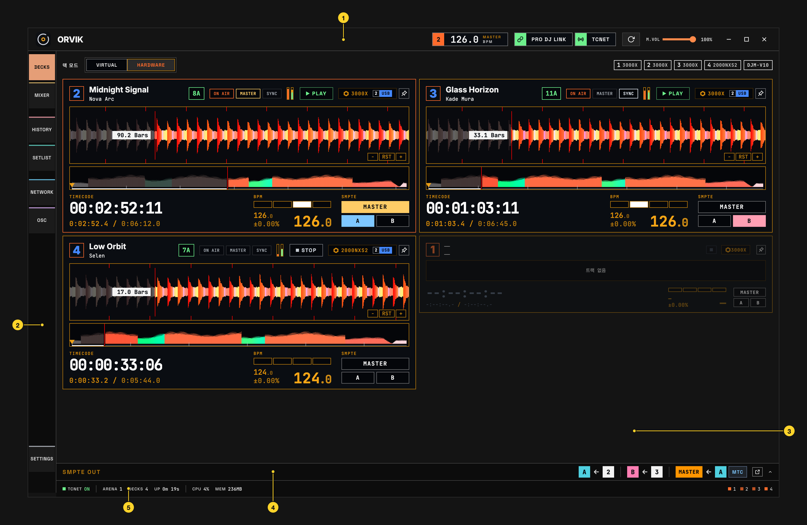

1. **Cabecera** — BPM maestro, interruptores PRO DJ LINK y TCNET, botón CUE CALL, volumen y botones de ventana. [Capítulo 3](#3-cabecera)
2. **Barra lateral** — elige la página. [Capítulo 4](#4-barra-lateral)
3. **Página** — la pantalla elegida en la barra lateral. La imagen muestra DECKS.
4. **Dock SMPTE OUT** — muestra y ajusta las salidas de código de tiempo. Pulse para desplegar. [Capítulo 7](#7-smpte-out)
5. **Barra de estado** — estado de la transmisión y de la aplicación. [Capítulo 5](#5-barra-de-estado)

Con una ventana CUE CALL acoplada, el panel de cue call aparece a la derecha de la página. [Capítulo 11](#11-cue-call)

---

## 3. Cabecera

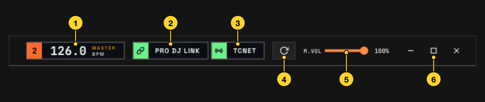

1. **MASTER BPM** — el BPM del maestro CDJ. Si el maestro no tiene BPM, se muestra el de un deck en reproducción, primero uno en el aire. La casilla izquierda es el número de reproductor del maestro.
2. **PRO DJ LINK** — activa y desactiva la conexión con CDJ y DJM.
3. **TCNET** — activa y desactiva la transmisión TCNet a los programas de iluminación y vídeo. Con el modo TCNet en Client en los ajustes, o en STANDBY, no se envía nada aunque esté activado.
4. **CUE CALL** — abre la ventana de cue call. [Capítulo 11](#11-cue-call)
5. **Recargar** — recarga la pantalla (Cmd/Ctrl+R). La reproducción de los decks virtuales se detiene.
6. **M.VOL** — el volumen del sonido de los decks virtuales que emite la aplicación. No afecta al audio de CDJ ni del mezclador.
7. **Botones de ventana** — en Windows: minimizar, maximizar y cerrar ORVIK. En macOS se usan los botones estándar de la esquina superior izquierda. Si hay un historial o un set list sin guardar, ORVIK pregunta si guardar al cerrar.

### Estado de los interruptores

Cuando PRO DJ LINK o TCNET está activado, su casilla izquierda se rellena con el color de estado: verde si todo va bien, un punto parpadeante mientras se activa. Si hay algo que revisar, aparece una de estas etiquetas dentro del interruptor.

| Etiqueta | Significado |
| --- | --- |
| NO H/W | PRO DJ LINK está activado pero no se ve ningún CDJ ni DJM. |
| LOST | Hay decks de hardware, pero ningún CDJ envía estado desde hace más de 1,5 s. |
| STANDBY | Hay un servidor TCNet iniciado antes en la misma red; la transmisión está en pausa, esperando. |

Cuando hay una versión nueva, aparece la insignia UPDATE en la cabecera. Pulse para abrir la página de descarga.

---

## 4. Barra lateral

| Menú | Contenido |
| --- | --- |
| DECKS | Formas de onda, código de tiempo y estado de reproducción por deck |
| MIXER | Faders de canal, EQ e indicadores de nivel del DJM |
| HISTORY | Registro de las pistas que salieron al aire |
| SET LIST | Set list, offsets de código de tiempo por pista y edición de cues |
| NETWORK | Equipos PRO DJ LINK y nodos TCNet |
| OUTPUT | Editor de nodos que envía valores de decks y mezclador como OSC, DMX y MIDI, y ajustes de Art-Net |
| MAP | Activa el modo que asigna un atajo pulsando un control. [Capítulo 14](#14-shortcut-y-map) |
| SHORTCUT | Control de ORVIK por teclado, MIDI, OSC y DMX |
| SETTINGS | Abre la ventana de ajustes. |

---

## 5. Barra de estado

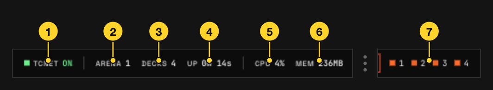

1. **TCNET** — si el interruptor TCNET de la cabecera está activado. En STANDBY no se envía nada aunque diga ON.
2. **ARENA** — número de nodos TCNet vistos en los últimos 10 s.
3. **DECKS** — decks de hardware más decks virtuales con pista cargada.
4. **UP** — tiempo desde que arrancó el motor.
5. **CPU** — uso de CPU de ORVIK.
6. **MEM** — memoria que usa ORVIK.
7. **Puntos de deck** — un punto por deck. Los decks de hardware muestran su color; los virtuales cambian de color según reproducción, cue, cargado o vacío.

Si algo falla, aparecen LINK, OUT o MIX en la barra de estado: LINK cuando hay números de reproductor repetidos, OUT cuando la transmisión TCNet se detuvo o la aplicación está en espejo, MIX cuando se cortaron los datos del mezclador. Pulsar uno lleva a la página relacionada. No aparecen mientras todo va bien.

---

## 6. DECKS

### 6.1 Modo de deck y equipos conectados

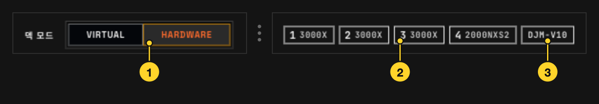

1. **Modo de deck** — HARDWARE sigue a los CDJ de la red PRO DJ LINK (predeterminado). VIRTUAL usa decks virtuales que reproducen archivos de audio de este ordenador. Cambiar de modo elimina los decks actuales; pasar a HARDWARE con decks virtuales pide confirmación. [6.4](#64-decks-virtuales)
2. **CDJ** — número y modelo de cada reproductor conectado. Pase el ratón para ver la IP; clic derecho para elegir el color del deck.
3. **DJM** — modelo del mezclador conectado. Se añade NO DATA si no llega ningún valor de control durante más de 1,5 s.

### 6.2 Tarjeta de deck

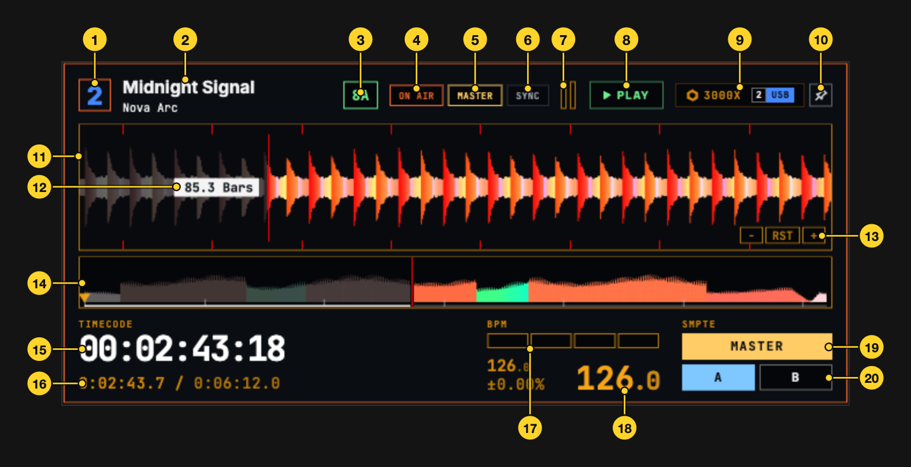

La imagen muestra una tarjeta en la disposición FLOW. Otras disposiciones omiten o mueven algunas partes.

1. **Número de reproductor** — clic derecho para elegir el color del deck.
2. **Título, artista**
3. **Tonalidad** — la tonalidad de la pista, en notación Camelot como 8A; las que no se pueden convertir se muestran tal cual.
4. **ON AIR** — encendido cuando el canal de este deck está en el aire en el mezclador.
5. **MASTER** — encendido cuando este deck es el maestro CDJ.
6. **SYNC** — encendido cuando Beat Sync está activo.
7. **Fader de canal, indicador de nivel** — posición del fader y nivel del canal en el DJM.
8. **Estado de reproducción** — PLAY, PAUSE, CUE, LOOP, etc.
9. **Modelo, soporte** — modelo del CDJ y soporte que contiene la pista (número de reproductor y USB o SD). El color del chip es el color del soporte definido en rekordbox; sin color es gris. Sin información de color se muestra texto en lugar del chip.
10. **Fijar en grande** — en FLOW, mantiene este deck en grande. Pulse de nuevo o cargue otra pista para soltarlo.
11. **Forma de onda de detalle** — la onda alrededor de la posición de reproducción. La línea roja es la posición.
12. **Contador de compases** — compases hasta el siguiente cue de memoria. Se pone rojo con 8 o menos; sin cue por delante muestra los compases transcurridos. Pulse para pasar a segundos.
13. **Zoom** — − amplía la vista (×2 por pulsación), + la reduce (mínimo 0,5 s). RST vuelve a los 8 s predeterminados.
14. **Forma de onda general** — toda la pista. En decks de hardware, mantener pulsado previsualiza la onda de detalle en ese punto; al soltar vuelve. Durante la vista previa, el contador muestra la distancia a la posición de reproducción en segundos o minutos:segundos.
15. **Código de tiempo** — el código de tiempo de la posición actual.
16. **Tiempo** — pulse para alternar entre transcurrido y restante. A la derecha, la duración.
17. **Posición del beat** — qué beat del compás suena.
18. **BPM** — arriba a la izquierda el BPM original, debajo el cambio de tempo (%), el número grande a la derecha es el BPM actual.
19. **SMPTE MASTER** — asigna este deck a la capa A o B y hace esa capa fuente de MASTER. Pulse de nuevo para soltar solo la fuente MASTER; la asignación A, B se mantiene. Las salidas LTC, MTC y Art-Net se activan aparte en SMPTE OUT.
20. **SMPTE A, B** — hace este deck fuente de la capa SMPTE A o B.

Con el color de onda en 3band y una pista sin datos 3band, aparece ! en el deck y la onda se muestra en RGB. Las ondas se dibujan en la tarjeta gráfica (GPU).

### 6.3 Disposiciones

Hay cuatro disposiciones de decks. Elija con **Tema de disposición** en [Ajustes](#15-ajustes).

<table>
<tr>
<td width="50%">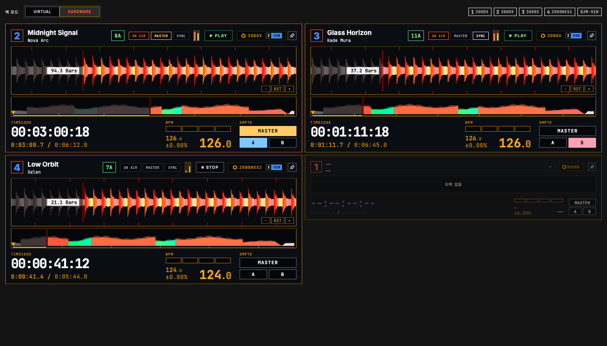 <b>FLOW</b> — ajusta el tamaño de los decks según el maestro CDJ, el aire y la reproducción. En una ventana ancha, hasta cuatro decks cargados se muestran en grande.</td>
<td width="50%">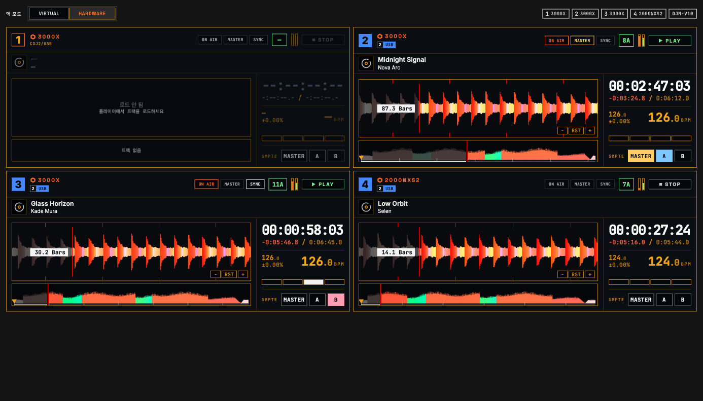 <b>STK</b> — apila todos los decks como tarjetas iguales, de dos en dos.</td>
</tr>
<tr>
<td>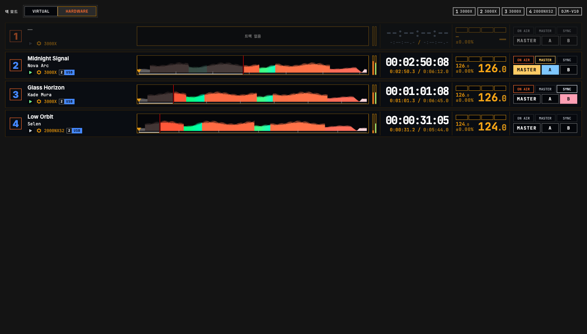 <b>STRIP</b> — una línea fina por deck. Solo se muestra la onda general.</td>
<td>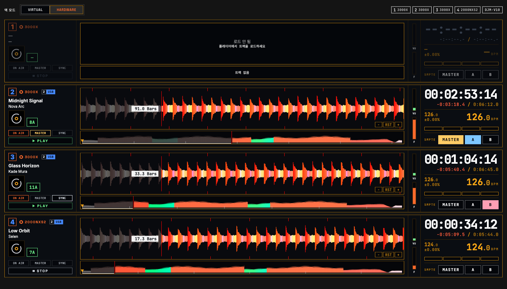 <b>ROW</b> — una fila por deck con ondas de detalle y general anchas.</td>
</tr>
</table>

### 6.4 Decks virtuales

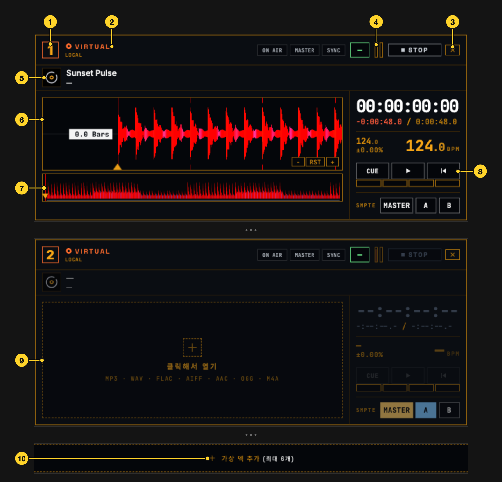

Con el modo de deck en VIRTUAL, los decks virtuales reproducen archivos de audio de este ordenador. La imagen muestra STK. Los botones de transporte (⑧) existen en todas las disposiciones salvo STRIP; en FLOW están entre el código de tiempo y el BPM.

1. **Número de deck**
2. **VIRTUAL, LOCAL** — indica un deck virtual cuya pista es un archivo de este ordenador.
3. **×** — elimina este deck virtual.
4. **Fader de canal** — arrastre para ajustar.
5. **Carátula** — pulse para descargar la pista.
6. **Forma de onda de detalle** — arrastre para mover la posición.
7. **Forma de onda general** — pulse o arrastre para mover la posición.
8. **|◀, CUE, ▶** — CUE en pausa fija el punto de cue y reproduce mientras se mantiene; en reproducción vuelve al punto de cue. ▶ reproduce y pausa; |◀ detiene y vuelve al inicio.
9. **Abrir** — pulse para elegir un archivo de audio o suelte uno aquí.
10. **Añadir deck virtual** — añade otro deck virtual, hasta 6.

Archivos admitidos: MP3, WAV, AIFF, FLAC, AAC, M4A (AAC, ALAC), OGG, MP4 (audio). Todo formato que abre un CDJ se abre aquí.

El audio de los decks virtuales sale por el dispositivo elegido en **Salida de audio** en [Ajustes](#15-ajustes); el volumen es M.VOL en la cabecera.

---

## 7. SMPTE OUT

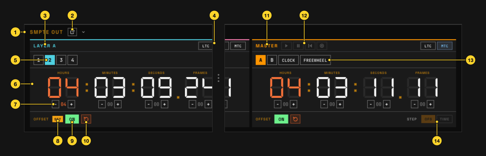

Hay tres capas de salida de código de tiempo: A, B y MASTER. Las capas A y B envían la posición del deck elegido; MASTER envía la capa A, la capa B, el reloj del ordenador o FREEWHEEL. La imagen muestra la capa A y MASTER; la capa B es igual que A.

1. **SMPTE OUT** — pulse para desplegar o plegar el dock. Plegado, resume la fuente y las salidas activas de cada capa.
2. **Separar** — abre SMPTE OUT en su propia ventana. Al cerrarla vuelve al dock.
3. **Capa A** — la capa que envía como código de tiempo la posición del deck elegido. La capa B es igual.
4. **LTC, MTC, ART** — activa y desactiva las salidas LTC (código de tiempo de audio), MTC (código de tiempo MIDI) y ART (código de tiempo Art-Net) de esta capa. LTC y ART pueden estar activos en cada capa; MTC solo en una. El dispositivo LTC y el puerto MTC se eligen en **Salida SMPTE Timecode** de [Ajustes](#15-ajustes); la red y la frecuencia de Art-Net, en la parte superior de la página [OUTPUT](#13-output).
5. **Deck fuente** — el deck que sigue esta capa. Igual que los botones A, B de la tarjeta.
6. **Código de tiempo** — la posición de la fuente más el offset. A la salida real se suma la compensación de latencia de los ajustes.
7. **− / +** — cambia cada campo en 1; con Ctrl (Cmd en Mac), en 10. Si STEP de MASTER es TIME, cambia el tiempo de FREEWHEEL; si no, el offset.
8. **SET** — indica que el offset del set list está cargado en esta capa. Pase el ratón para ver la pista. Con el offset UNLISTED, por no estar la pista en la lista, se lee SET —.
9. **OFFSET ON** — incluye el offset en la salida o lo excluye. El valor se conserva.
10. **Restablecer** — pone el offset a 0.
11. **MASTER** — la capa MASTER.
12. **Botones FREEWHEEL** — ▶ hace correr el código FREEWHEEL, ❚❚ lo pausa conservando el valor, |◀ vuelve a 00:00:00:00. READY (◉) mantiene FREEWHEEL en el valor actual y lo arranca cuando un deck empieza a reproducir. Con mezclador, solo cuentan los decks en el aire en ese instante; los que ya reproducían y las escuchas con CUE no.
13. **Fuente** — A y B envían el código de esa capa más el offset de MASTER. CLOCK usa la hora del ordenador; FREEWHEEL corre por su cuenta desde el último valor de MASTER.
14. **STEP** — con la fuente MASTER en FREEWHEEL, si − / + cambia el offset (OFS) o el tiempo FREEWHEEL (TIME).

Con un deck detenido, LTC sigue enviando el código de la posición detenida, el mismo cuadro repetido, para que el receptor sepa que se detuvo.

---

## 8. MIXER

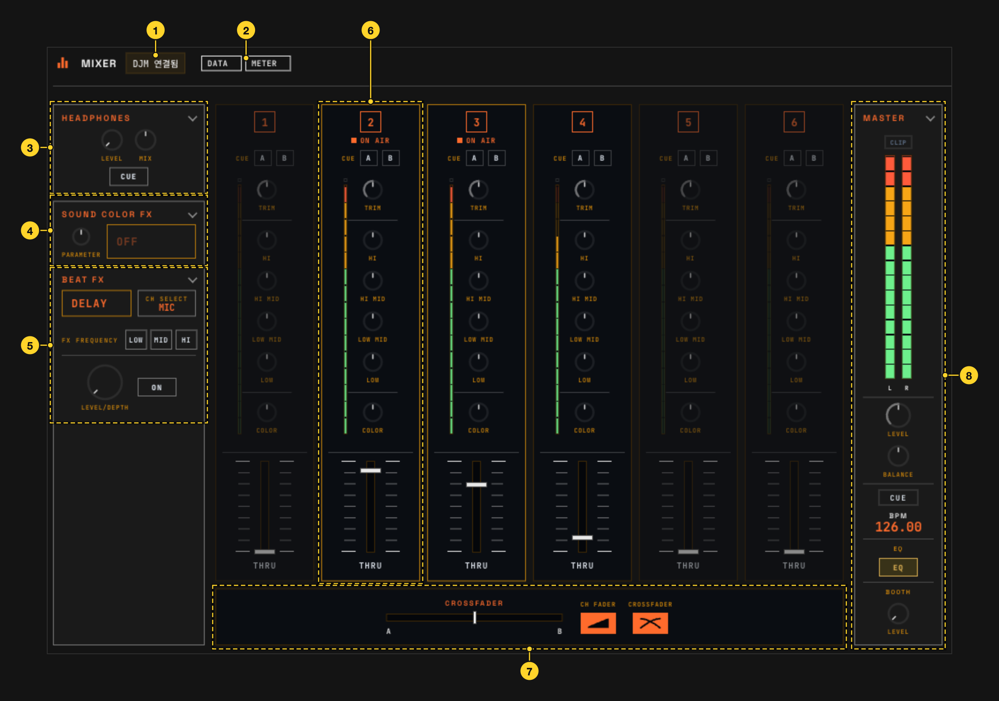

Muestra el estado que envía el DJM. ORVIK no cambia los ajustes del mezclador. El número de canales y algunos elementos dependen del modelo.

1. **Conexión DJM** — si el DJM está visible.
2. **DATA, METER** — DATA: llegan valores de control (faders, EQ); METER: llegan valores de los indicadores de nivel.
3. **HEADPHONES** — sección de auriculares. [8.1](#81-auriculares-y-efectos)
4. **SOUND COLOR FX** — sección de sound color FX. [8.1](#81-auriculares-y-efectos)
5. **BEAT FX** — sección de beat FX. [8.1](#81-auriculares-y-efectos)
6. **Canales** — una sección igual por canal. [8.2](#82-canales)
7. **Crossfader** — posición del crossfader y curvas CH FADER y CROSSFADER.
8. **MASTER** — sección master. [8.3](#83-master)

<table>
<tr>
<td align="center">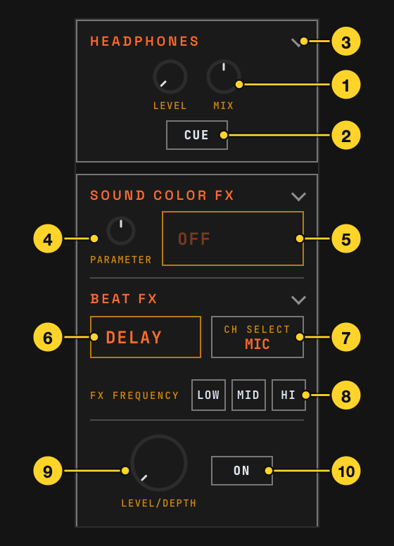 8.1 Auriculares y efectos</td>
<td align="center">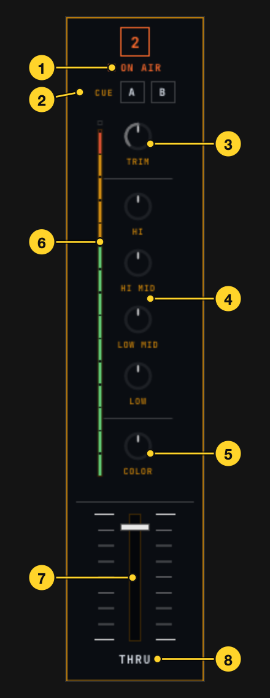 8.2 Canales</td>
<td align="center">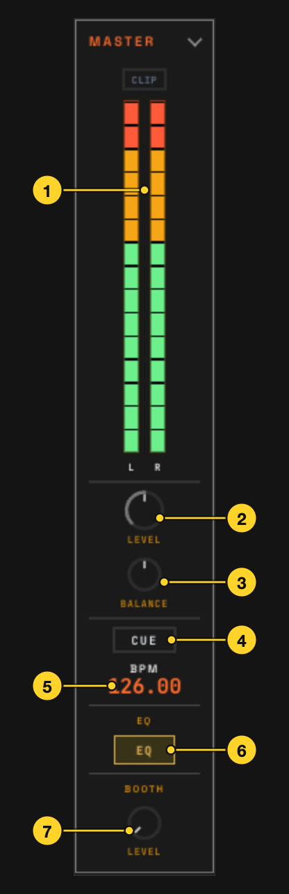 8.3 MASTER</td>
</tr>
</table>

### 8.1 Auriculares y efectos

1. **LEVEL, MIX** — posición del LEVEL de auriculares y balance CUE/master (MIX).
2. **CUE** — encendido cuando el master se escucha en los auriculares.
3. **Plegar** — pulse el nombre de la sección para plegarla o desplegarla.
4. **PARAMETER** — posición del PARAMETER de SOUND COLOR FX.
5. **Efecto SOUND COLOR FX** — el efecto elegido; OFF si ninguno.
6. **Efecto BEAT FX** — el efecto elegido.
7. **CH SELECT** — canal al que se aplica BEAT FX.
8. **FX FREQUENCY** — banda (LOW, MID, HI) a la que se aplica BEAT FX.
9. **LEVEL/DEPTH** — posición del LEVEL/DEPTH de BEAT FX.
10. **ON** — encendido cuando BEAT FX está activo.

En DJM con dos salidas de auriculares se muestran también LEVEL, MIX y LINK CUE de los auriculares B. LINK CUE se enciende al escuchar el LINK MONITOR de rekordbox.

En DJM con sección FILTER se muestran el filtro elegido (LPF, HPF) y la posición de RESONANCE.

### 8.2 Canales

1. **ON AIR** — encendido cuando este canal está en el aire.
2. **CUE, A, B** — estado CUE de auriculares del canal. Con dos auriculares, A y B aparecen por separado.
3. **TRIM** — posición de TRIM.
4. **EQ** — posiciones de HI, HI MID, LOW MID y LOW. El número de bandas depende del modelo.
5. **COLOR** — posición de SOUND COLOR FX.
6. **Indicador de nivel** — nivel del canal. CLIP arriba se enciende si la entrada satura.
7. **Fader de canal** — posición del fader.
8. **Asignación de crossfader** — A, THRU o B para este canal.

### 8.3 MASTER

1. **Indicador master** — nivel master L, R. CLIP se enciende si la salida satura.
2. **LEVEL** — posición de MASTER LEVEL.
3. **BALANCE** — posición de MASTER BALANCE. C es el centro.
4. **CUE** — encendido cuando el master se escucha en los auriculares.
5. **BPM** — BPM de un CDJ en reproducción. Con varios, el del deck de número más bajo.
6. **EQ, ISO** — estado del EQ master. Cambia a ISO con MASTER ISOLATOR activo.
7. **BOOTH LEVEL** — posición de BOOTH LEVEL.

---

## 9. HISTORY

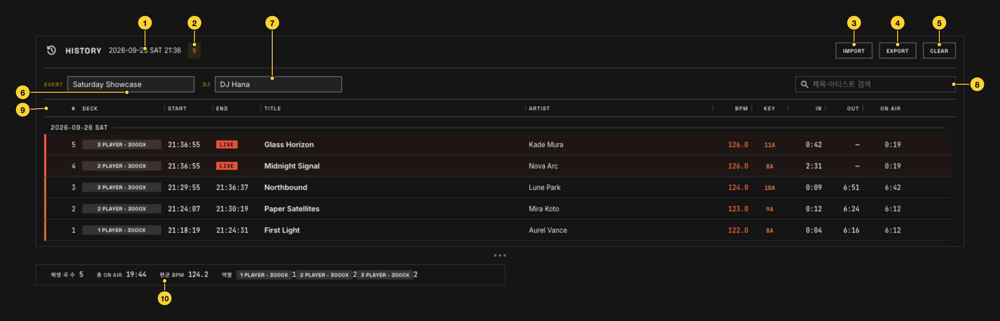

Registra las pistas que salieron al aire con la hora real y el número de deck. Con mezclador se cuenta el tiempo en reproducción y en el aire; sin él, el tiempo en reproducción. Una pista se registra tras 10 s. Si la reproducción o el aire se interrumpe más de 3 s y vuelve, la misma pista ocupa una línea nueva; en menos de 3 s continúa la misma. Los decks virtuales se registran al cargar la pista y se cuenta el tiempo reproducido. La pista en el aire muestra LIVE en END.

El registro empieza de cero en cada arranque. Se guarda automáticamente y, tras un cierre anómalo, ORVIK pregunta en el siguiente arranque si continuarlo.

1. **Hora de inicio** — fecha y hora en que empezó este registro.
2. **Número de pistas** — pistas registradas.
3. **IMPORT** — carga un archivo de historial (CSV de ORVIK, CSV o TXT de historial ShowKontrol) en el registro actual. Las entradas se añaden tal cual.
4. **EXPORT** — guarda en el formato elegido: CSV de ORVIK (recargable en ORVIK), historial ShowKontrol, set list ShowKontrol o TXT de lista de pistas.
5. **CLEAR** — borra el registro. Pulse de nuevo en 3 s para confirmar.
6. **EVENT** — nombre del evento. Va en los nombres de archivo exportados (CSV, set list, lista de pistas) y en el cuerpo del TXT.
7. **DJ** — nombre del DJ. Va en el cuerpo del TXT.
8. **Buscar** — busca por título o artista.
9. **Cabecera de la tabla** — arrastre un borde para cambiar el ancho; doble clic para restablecer. Columnas:
   - **DECK** — número de reproductor y modelo.
   - **START, END** — cuándo salió al aire y cuándo dejó de estarlo.
   - **IN, OUT** — posiciones de reproducción al entrar y salir del aire.
   - **ON AIR** — tiempo en el aire.
10. **Totales** — pistas reproducidas, tiempo ON AIR total, BPM medio y pistas por deck.

Al pasar el ratón por una fila aparecen a la derecha un botón para añadirla al set list y otro para borrarla. Borrar la pista en el aire deja de registrarla mientras siga sonando.

---

## 10. SET LIST

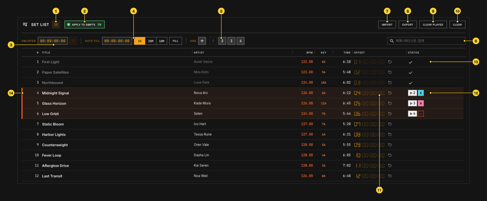

Una lista con un offset de código de tiempo y cues para cada pista. Con APPLY TO SMPTE activado, al cargar una pista de la lista en un deck, su offset entra en la capa SMPTE (A, B) a la que está conectado ese deck. Como el historial, el set list se vacía en cada arranque; el guardado automático y la recuperación funcionan igual.

1. **Número de pistas** — pistas en la lista.
2. **APPLY TO SMPTE** — activado: el offset de la pista cargada entra en la capa de ese deck. Desactivado: los offsets de capa se mantienen.
3. **UNLISTED** — offset para las pistas que no están en la lista. El botón contiguo lo pone a 00:00:00:00.
4. **AUTO FILL** — fije un valor inicial y un paso (1H, 30M, 10M) y pulse FILL para rellenar los offsets en orden. Sin paso, todas reciben el mismo valor.
5. **ADD** — + añade una pista escrita a mano; un número de deck añade la pista cargada en ese deck.
6. **Buscar** — busca por título o artista.
7. **IMPORT** — carga un set list: archivo de ORVIK, set list ShowKontrol (.set) o historial (.csv), lista de texto exportada de rekordbox u otros, o archivos de audio. Con una lista existente pregunta si reemplazar (REPLACE) o añadir (ADD), y pide elegir columnas si no reconoce las de un archivo de texto. Los archivos de ORVIK incluyen los cues.
8. **EXPORT** — guarda en el formato elegido: archivo de ORVIK o set list ShowKontrol (.set).
9. **CLEAR PLAYED** — borra solo las marcas de reproducido.
10. **CLEAR** — borra la lista. Pulse de nuevo en 3 s para confirmar. Los cues de las pistas se borran con ellas.
11. **OFFSET** — offset de esta pista. Al cargarla en un deck, este valor entra en la capa. Pulse para editar; el botón contiguo lo pone a 00:00:00:00.
12. **STATUS (en un deck)** — deck donde está cargada la pista y capa (A, B) que recibió su offset.
13. **STATUS (reproducida)** — aparece una marca cuando la pista se reprodujo y salió al aire con APPLY TO SMPTE activado. Sin mezclador solo cuenta la reproducción. Si la misma pista aparece varias veces, se usa el offset de una línea sin marca; si aparece una vez, se reutiliza su offset.
14. **Pista en un deck** — las filas de pistas cargadas se resaltan.

Pulse un título o artista para editarlo. Los botones a la derecha de la fila mueven la pista arriba o abajo o la eliminan. Arrastre un borde de la cabecera para cambiar el ancho; doble clic para restablecer. La columna **forma de onda** de cada fila es el origen de la onda usada en la edición de cues (archivo de audio, HISTORY, CDJ, ninguno) y la columna **cues** es el número de cues de la pista.

### 10.1 Edición de cues

El editor de cues se abre a la derecha de la página SET LIST. Al elegir una pista se muestran su onda y su lista de cues.

- **Forma de onda** — la pista completa y una parte ampliada, con la rejilla de beats, los números de compás, las bandas de frase y las marcas de cue. La onda procede del archivo de audio, del registro de HISTORY o de la recibida del CDJ, la que exista. Las ondas del CDJ requieren la biblioteca de pistas activada (el editor ofrece activarla). Sin onda, los cues se colocan solo por tiempo.
- **Mover la posición** — pulse la onda para mover la posición de edición. **Ajuste** (no, beat, compás, cuadro) la alinea a la rejilla. **Zoom** cambia el rango ampliado.
- **+ Cue (C)** — crea un cue en la posición de edición. Con archivo de audio, se previsualiza ese punto.
- **Importar hot cues** — trae los hot cues y puntos de memoria de rekordbox como posiciones de cue.
- **Lista de cues** — tiempo, compás.beat, nombre, grupo y resumen de acciones.
- **Ajustes del cue** — nombre, tiempo, compás.beat, grupo, aviso (predeterminado o un número de beats), voz (seguir al grupo, sí, no), qué decir (vacío: el nombre del cue) y lista de acciones.
- **Lista de acciones** — se ejecuta en orden desde arriba: OSC (destino, dirección, tipo i/f/s, valor), Art-Net DMX (universo, varios canal=valor), MIDI (dispositivo, canal, Note on/off, CC, Program) y espera (ms, o beats y compases). La lista de destinos es la misma que en OUTPUT.
- **Grupo** — el grupo de equipo del cue. Los grupos predeterminados son Luces, Vídeo, SFX y Láser; **Editar grupos…** en el menú de grupo los renombra, recolorea o añade. Los grupos rigen la ventana de cue call y las salidas de voz.
- **Salida de cues** — el interruptor sobre el editor activa y desactiva el envío de acciones.

Los cues reaccionan solo a la pista que suena en el deck maestro. Si esa pista no está en el set list, no se envía ningún cue. El beat del cue se calcula con la rejilla de beats y la posición de reproducción. Los cues pertenecen a la entrada del set list, así que la misma pista tiene cues distintos en cada set list.

---

## 11. CUE CALL

El botón CUE CALL de la cabecera abre la ventana de cue call. Muestra por grupo los cues de la pista del deck maestro y cuenta atrás hasta el siguiente. Pueden abrirse varias ventanas (por ejemplo una para luces, otra para SFX); posición, tamaño y ajustes de visualización se recuerdan por ventana. El botón de la barra de título la acopla a la derecha de la ventana principal y la desacopla.

### Temas

- **Tablero** — una tarjeta por grupo: nombre del cue, siguiente cue, cuenta atrás grande y barra de progreso de los últimos 8 compases. Al acercarse el cue, la tarjeta se llena del color del grupo; en el cue muestra GO.
- **Capas** — una línea de tiempo que fluye: arriba la onda del deck maestro con sus marcas de cue, abajo una línea por grupo y la de la siguiente pista. La línea NOW está al 20 % del ancho; un cue se dispara cuando la toca.

### Tiempo restante

Segundos y beats (compás.beat, al estilo de la cuenta atrás de beats del CDJ) juntos: `2.3` significa 2 compases y 3 beats. Dentro de la cuenta atrás grande, los segundos toman el color del grupo en pasos de 0,1 s, los últimos beats cuentan 3 2 1 (o desde 5 o 10) y aparece GO. Pulsar el número alterna entre segundos primero, beats primero y solo segundos.

### Ventana de ajustes (la rueda)

| Sección | Elementos |
| --- | --- |
| Pantalla | tiempo restante (segundos primero, beats primero, solo segundos), cuenta atrás grande (5, 10, 15, 30 s), cuenta de beats desde (3, 5, 10), rango de la línea de tiempo, grupos visibles, color de la onda (pista, grupo, gris) |
| Vista web | la dirección para teléfonos y tabletas, **Copiar dirección**, **Abrir en el navegador**. El visor web debe estar activado en los ajustes. |
| Voz | hablar (nombre + cuenta, solo nombre, solo cuenta), aviso (8 beats, 4 beats), cuenta atrás (3, 2, 1 o ninguna), última palabra (sí, no), voz, clic (ninguno, durante la cuenta, siempre) y su volumen, salida (dispositivo, canal, volumen, prueba), silencio por grupo |

### Llamadas habladas

El altavoz de la cabecera de la ventana activa y desactiva las llamadas habladas. Las frases se generan de antemano con las voces del sistema (macOS, Windows) y se reproducen al beat durante el show.

- 8 (o 4) beats antes del cue: "grupo, nombre del cue, standby"; en cada beat "tres, dos, uno"; en el cue "ya".
- La lista de **voz** muestra solo voces de los idiomas que la aplicación puede hablar (coreano, inglés, japonés, español, alemán, francés, chino), agrupadas por idioma. La primera entrada, "Voz del sistema en …", es la voz predeterminada del idioma de la interfaz. Elegir una voz de otro idioma cambia las llamadas a ese idioma (una voz inglesa dice "Lighting, standby", "three, two, one, go"). Los nombres de grupo escritos en el set list se leen tal cual.
- Sin voz para el idioma, las llamadas son en inglés y la primera entrada lo indica. Las voces se añaden en los ajustes de voz del sistema operativo.
- La **salida** puede ser otro canal del dispositivo que usa LTC, pero no el canal de LTC; elegir el mismo canal muestra un aviso de conflicto.
- El altavoz junto a un nombre de grupo silencia ese grupo. Los grupos ocultos en la ventana no se hablan.

### Página web

Con el visor web activado en los ajustes, los teléfonos, tabletas y otros ordenadores de la misma red abren `http://<este ordenador>:<puerto>/cuecall`. Pide primero el código de acceso (el mismo del visor web) y lo recuerda 12 horas. Los temas tablero y capas y los ajustes de pantalla se eligen en ese dispositivo. Hay una disposición para teléfono en vertical.

---

## 12. NETWORK

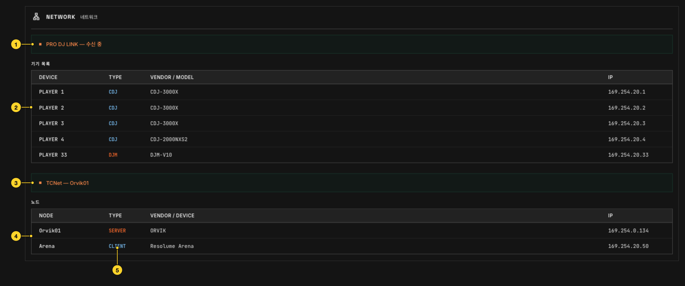

1. **Estado de PRO DJ LINK** — si ORVIK está listo para recibir PRO DJ LINK. Que haya CDJ visibles se ve en la lista de equipos.
2. **Lista de equipos** — número, tipo, modelo e IP de cada CDJ y DJM visto.
3. **Estado de TCNet** — si el interruptor TCNET está activado y el nombre de nodo de ORVIK.
4. **Lista de nodos** — ORVIK y los nodos TCNet vistos en los últimos 10 s.
5. **TYPE** — el rol del nodo: SERVER envía, CLIENT recibe; también REPEATER y AUTO. Con TCNet activado y ningún CLIENT, aparece una nota bajo la lista.

---

## 13. OUTPUT

Envía valores de decks y mezclador a otros programas y equipos como OSC, DMX (Art-Net, sACN) y MIDI. Es un editor de nodos que une la antigua página OSC y el parche DMX de ART-NET. Las filas OSC y parches DMX de 1.6 se convierten en nodos en el primer arranque y envían los mismos valores.

### Parte superior

- **IMPORT, EXPORT** — guarda el grafo de nodos en un archivo o lo carga.
- **OSC** — destino OSC (dirección:puerto): este ordenador, una IP o difusión.
- **Red Art-Net** — interfaz de red para Art-Net y frecuencia DMX (Hz).
- **Código de tiempo Art-Net** — frecuencia de cuadros del código de tiempo Art-Net. Cada capa se activa con el botón ART en SMPTE OUT.
- **MIDI** — dispositivo MIDI de salida.
- **Escanear** — vuelve a buscar equipos Art-Net (ArtPoll) y dispositivos MIDI.

### Lista izquierda

Pulsar un elemento crea su nodo en el lienzo.

| Grupo | Nodos |
| --- | --- |
| Destinos | OSC, salida DMX, MIDI CC, MIDI Note |
| Valores (canales 1–6 del mezclador) | Fader, VU, Hi, Mid, LoMid, Low, Color, OnAir |
| Valores (mezclador completo, efectos) | Xf, MVU, MVUL, MVUR, BeatFX, BeatFXOn, BeatFXName, BeatFXCh, ColorFXName |
| Valores (tempo del deck) | BPM, BPMCoarse, BPMFine, Beat, Downbeat, Phase, BarBeat, BarPhase |
| Valores (tiempo del deck, frases) | Pos, Time, Length, Remain, Phrase, PhraseKind, PhrasePos, PhraseBeats |
| Valores (estado del deck, pista) | Loop, Sync, Master, CDJPlay, CDJCue, Deck, Title, Artist, Key |
| Valores (salida SMPTE) | SMPTEA, SMPTEB, SMPTEM, Clock |
| Transformaciones | Rango, Forma (sin, tri, saw, sq), Invertir, Libre, Formato de tiempo |
| Operaciones | Sumar, Restar, Multiplicar, Dividir, Mín, Máx, Suavizar, Salto de línea |

### Lienzo y ajustes de la derecha

Arrastre la salida de un nodo de valor a la entrada de una transformación, operación o destino. El valor que fluye se ve sobre el cable. Un valor puede ir a varios destinos. Al seleccionar un nodo, sus ajustes aparecen a la derecha (deck, rango, dirección, canal, tipo, valor actual). El deck de un nodo de valor es "seguir al maestro" o deck 1–6.

- **OSC** — dirección y tipo (int, float, string). Se envía solo al cambiar, a 60 Hz como máximo. Se añade la `/` inicial si falta; no se admiten espacios ni `# * , ? [ ] { }`.
- **Salida DMX** — Net, Subnet, Universe y canal. Los valores 0–1 se envían como 0–255. El receptor (IP unicast o difusión) y la prioridad sACN se fijan en el nodo.
- **MIDI CC, MIDI Note** — canal y número de CC o de nota. Los valores 0–1 se envían como 0–127.
- **Rango** — convierte 0–1 en mín–máx. Un mín mayor que el máx invierte el sentido. BPM trata 20–500 BPM como 0–1.
- **Forma** — convierte 0–1 en una onda sin, tri, saw o sq; **Invertir** es 1 − valor. **Libre** corre por su cuenta con el periodo elegido, sin entrada.
- **Formato de tiempo** — elige los campos (hh, mm, ss, ff) de un valor de tiempo (Time, Length, Remain, SMPTE, Clock). Véase "Formato de tiempo".
- **Salto de línea** — une valores de texto en varias líneas (por ejemplo título / artista).

Los valores se calculan en el motor de salida, así que siguen enviándose mientras se muestra otra página.

### Nombres de valor y qué envían

Valores enviados sin rango.

| Grupo | Nombre | Valor |
| --- | --- | --- |
| Por canal del mezclador (1–6) | Fader, VU, Hi, Mid, LoMid, Low, Color | 0–1 |
| | OnAir | 1 en el aire, si no 0 |
| Mezclador completo | Xf, MVU, MVUL, MVUR, BeatFX | 0–1 |
| | BeatFXOn | 1 con beat FX en ON |
| | BeatFXName, BeatFXCh, ColorFXName | beat FX elegido, canal al que se aplica, nombre del colour FX (string) |
| Por deck y deck maestro | BPM | el BPM tal cual (como string, un decimal: `128.0`). BPMCoarse es la parte entera, BPMFine la fracción |
| | Pos | progreso 0–1 (como string `42%`) |
| | Beat, Downbeat | un 1 breve en cada beat, un 1 breve en el primer beat del compás |
| | Phase | posición dentro del beat 0–1 |
| | BarBeat | qué beat del compás, 1–4 |
| | BarPhase | posición dentro del compás 0–1 (un ciclo por cuatro beats) |
| | Phrase | nombre de frase de rekordbox (string, p. ej. `CHORUS`) |
| | PhraseKind | número de frase: Intro 1, Verse 2, Bridge 3, Chorus 4, Up 5, Down 6, Outro 7 (0 sin frase) |
| | PhrasePos, PhraseBeats | posición dentro de la frase 0–1, beats hasta la siguiente |
| | Loop, Sync | 1 en loop, 1 con sync activo |
| | Title, Artist, Key | título, artista y tonalidad (string) |
| | Time, Length, Remain | tiempo transcurrido, total y restante (string, `MM:SS`, restante como `-MM:SS`) |
| Solo por deck | CDJPlay, CDJCue | 1 en reproducción, 1 mientras se mantiene CUE |
| | Master | 1 si ese deck es el maestro CDJ |
| Solo deck maestro | Deck | número de reproductor del maestro 1–6 |
| SMPTE, reloj | SMPTEA, SMPTEB, SMPTEM | código de tiempo de las capas A, B, MASTER de SMPTE OUT tal como se ve en el dock (string, `HH:MM:SS:FF`, drop frame 29,97 `HH:MM:SS;FF`, con offset) |
| | Clock | hora del ordenador (string, `HH:MM:SS`) |

- El deck maestro es el del MASTER BPM de la cabecera. Sin maestro CDJ se usa un deck en reproducción, primero uno en el aire.
- El BPM enviado a la dirección de tempo de Resolume (`/composition/tempocontroller/tempo`) va como 0–1 (20–500 BPM), porque Resolume espera 0–1 ahí.
- Sin mezclador no se envían valores del mezclador, porque un 0 apagaría una capa ligada a un fader. Tampoco se envía el BPM de un deck sin BPM.
- Los valores de encendido/apagado (OnAir, BeatFXOn, Loop, Sync, CDJPlay, CDJCue, Master) y Deck también pueden enviarse como string (`ON`, `OFF`, `2`).

### Formato de tiempo

Un nodo de formato de tiempo sobre un valor de tiempo envía solo los campos elegidos.

| Letras | Campo |
| --- | --- |
| `hh`, `h` | horas |
| `mm`, `m` | minutos |
| `ss`, `s` | segundos |
| `ff`, `f` | cuadros (solo SMPTE) |

Dos letras envían el campo con cero a la izquierda en dos dígitos; una letra, tal cual. Varios campos se unen con `:` (p. ej. `mmss` → `05:08`, `hmmss` → `0:05:08`). Los tiempos de pista sin `h` siguen contando minutos más allá de 60. Remain con formato se envía sin el `-`. El código 29,97 drop frame lleva `;` antes de los cuadros.

---

## 14. SHORTCUT y MAP

Teclado, MIDI, OSC y DMX (Art-Net) pulsan los botones de ORVIK y cambian sus valores. Solo se configura la recepción; el estado de un botón asignado puede devolverse por MIDI OUT.

### Página SHORTCUT

| Sección | Contenido |
| --- | --- |
| Teclado | combinaciones de teclas, solo cuando la ventana de ORVIK está delante. |
| Entrada MIDI | el dispositivo MIDI que se escucha (todos o uno). Con OUT activado, el estado de los botones asignados se devuelve a ese dispositivo (LED del controlador). |
| Entrada OSC | puerto de recepción OSC, dónde escuchar (todas las interfaces o solo este ordenador) y la lista de IP autorizadas. Una lista vacía deja controlar a cualquiera de la red: anote las IP en el recinto. |
| Entrada DMX (Art-Net) | control desde canales de un universo Art-Net. Puede recibir junto a Resolume en el mismo ordenador. |
| Asignar desde un botón | **MAP activado** entra en el modo de asignación. |

La lista de asignaciones muestra para cada acción la tecla, el MIDI (canal, nota o CC), la dirección OSC y el canal DMX, y permite quitarlos.

### MAP

MAP en la barra lateral (o MAP activado en SHORTCUT) entra en el modo de asignación. Pulse un botón de la pantalla para fijarlo; la siguiente tecla, entrada MIDI, mensaje OSC o canal DMX se asigna a ese botón. Esc sale del modo. Los botones asignables se resaltan con un borde mientras el modo está activo.

---

## 15. Ajustes

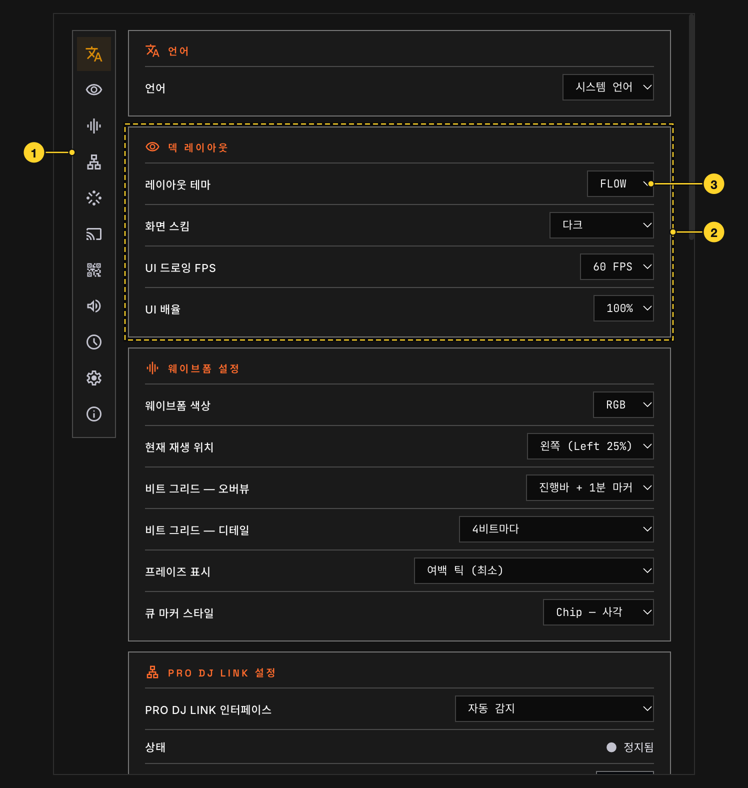

SETTINGS en la barra lateral abre la ventana de ajustes.

1. **Iconos de sección** — pulse para ir a esa sección.
2. **Secciones** — los ajustes se agrupan como sigue.
3. **Ajustes** — nombre a la izquierda, valor a la derecha.

### Idioma

| Elemento | Descripción |
| --- | --- |
| Idioma | idioma de la interfaz. Idioma del sistema sigue al ordenador. 한국어, English, 日本語, Español, Deutsch, Français, 繁體中文. |

### Disposición de decks

| Elemento | Descripción |
| --- | --- |
| Tema de disposición | disposición de la pantalla de decks: FLOW, STK, STRIP o ROW. [6.3](#63-disposiciones) |
| Modo de pantalla | oscuro o claro. |
| FPS de pantalla | veces por segundo que se redibuja la pantalla. Bajarlo usa menos CPU. Las frecuencias de envío son independientes. |
| Escala de la interfaz | tamaño de toda la pantalla. |

### Forma de onda

| Elemento | Descripción |
| --- | --- |
| Color de la onda | 3band, RGB o mono. Las pistas sin datos 3band se muestran en RGB. |
| Posición de reproducción | dónde se sitúa la línea de posición en la onda de detalle. |
| Rejilla de beats: general | la rejilla dibujada en la onda general. |
| Rejilla de beats: detalle | la rejilla de beats dibujada en la onda de detalle. |
| Frases | cómo se muestran las frases (INTRO, CHORUS, etc.) en la onda. |
| Estilo de marcador de cue | forma de las marcas de cue dibujadas en la onda. |

### PRO DJ LINK

| Elemento | Descripción |
| --- | --- |
| Interfaz PRO DJ LINK | interfaz de red donde están CDJ y DJM. La detección automática elige el lado donde se ven CDJ. |
| Estado | estado de conexión de esta interfaz. |
| Lista de interfaces | Actualizar relee la lista; púlselo tras conectar un adaptador. Una interfaz elegida que falta queda como "ausente" y mientras tanto el motor usa la detección automática. |
| Inicio automático de PRO DJ LINK | activa PRO DJ LINK al arrancar ORVIK. |
| Puertos | los puertos UDP que usa PRO DJ LINK. ORVIK avisa si otro programa los ocupa. |

### TCNet

| Elemento | Descripción |
| --- | --- |
| Node Name | nombre de este ordenador en TCNet. %% es un número automático; 8 caracteres como máximo. |
| Interfaz TCNet | interfaz de red por la que se envía TCNet. |
| Estado | estado de conexión de esta interfaz. |
| Frame Rate | frecuencia de cuadros del código de tiempo enviado por TCNet. |
| Modo TCNet | Auto espera si hay un servidor anterior, Server siempre envía, Client nunca envía. |
| Inicio automático de TCNET | activa la salida TCNET al arrancar ORVIK. |
| Puertos | los puertos UDP que usa TCNet. |

### Modo espejo

| Elemento | Descripción |
| --- | --- |
| Servir espejo | permite que ORVIK en otro ordenador refleje este. |
| Reflejar otro PC | muestra la pantalla de ORVIK de otro ordenador. |
| Servidor espejo | el servidor que se refleja. Actualizar vuelve a buscar. |
| Puertos | el puerto TCP que usa el espejo. |

En espejo, MIRROR y la dirección del servidor sustituyen a los botones PRO DJ LINK y TCNET de la cabecera; CONNECTING aparece antes de conectar y al reconectar. Un ordenador en espejo no envía TCNet. Pulsar MIRROR abre los ajustes.

### Visor web

| Elemento | Descripción |
| --- | --- |
| Visor web | permite ver la pantalla de decks y la página de cue call desde navegadores de la misma red (solo lectura). |
| Puerto | puerto del visor web. |
| Interfaz | interfaz de red donde escucha el visor web. |
| Estado | dirección y estado del visor web; activado, el código de acceso y un código QR. |

### Salida de audio

| Elemento | Descripción |
| --- | --- |
| Dispositivo de salida | dispositivo de audio para los decks virtuales. |
| Canales de salida | canales de salida para los decks virtuales. |

### Salida SMPTE Timecode

| Elemento | Descripción |
| --- | --- |
| Frame Rate | frecuencia de cuadros de LTC y MTC. |
| Compensación de latencia | ms que se suman al código de tiempo; positivo adelanta. Común a LTC, MTC y Art-Net, para compensar el retardo del receptor. |
| LTC: Layer A, Layer B, MASTER | dispositivo de audio y canal del LTC de cada capa. |
| La capa MASTER sigue al deck maestro | con MASTER siguiendo a A o B, si el maestro CDJ pasa al deck de la otra capa, MASTER pasa a esa capa. |
| Salida MIDI de MTC | puerto MIDI para MTC. |

### Archivo de ajustes

| Elemento | Descripción |
| --- | --- |
| Copia de seguridad | guarda los ajustes en un archivo (.orvikcfg) o carga uno. Al cargar, ORVIK se reinicia. Historial, set list y posiciones de ventana no van en el archivo. También se cargan los archivos de 1.6; sus filas OSC y parche DMX se convierten en nodos de OUTPUT. |
| Restablecer | devuelve todos los ajustes a su valor inicial y reinicia. |

### Acerca de

| Elemento | Descripción |
| --- | --- |
| Versión | versión actual de ORVIK. |
| Buscar actualizaciones | activado, busca una versión nueva tras el arranque y cada 12 horas. |
| Aviso de prelanzamientos | también avisa de versiones de prelanzamiento. |
| Comprobar ahora | comprueba al momento; con versión nueva aparece el botón de la página de descarga. |
| Copyright | notas de copyright y licencia de ORVIK y JUCE, y el botón REPORT para consultas. |
| Código abierto | abre la carpeta de licencias incluida en la aplicación (en Windows se extrae a una carpeta temporal) o la guía de licencias de código abierto. |

---

## 16. Marcas y licencias

ORVIK es una herramienta de compatibilidad independiente. No es el PRO DJ LINK Bridge oficial de AlphaTheta ni el ShowKontrol de TC Supply, y no implica afiliación, patrocinio, certificación ni aprobación de AlphaTheta, Pioneer DJ, TC Supply o Resolume.

AlphaTheta, Pioneer DJ, CDJ, DJM, PRO DJ LINK, rekordbox, TC Supply, TCNet, ShowKontrol, Resolume, SMPTE y otros nombres de productos, tecnologías y marcas se usan para describir la compatibilidad. Los derechos de cada marca pertenecen a su titular. Art-Net™ Designed by and Copyright Artistic Licence.

ORVIK usa el framework JUCE 9, los componentes de código abierto incluidos con él y las fuentes. La lista y los textos de licencia están en la sección **Acerca de** de la ventana de ajustes y en THIRD_PARTY_NOTICES. Las condiciones de uso de la aplicación están en BINARY_LICENSE.
